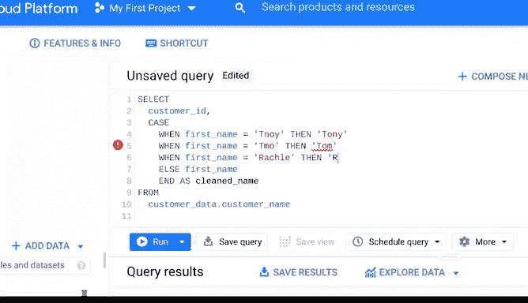

# 谷歌数据分析师第四课《从脏数据到干净数据的处理》process-data（中英字幕）deepseek翻译 - P30：30_04_04_数据清洗验证.zh_en - GPT中英字幕课程资源 - BV19m4y1J7dG

Hey there。 In this video， we'll continue building on the verification process As a quick reminder。

 the goal is to ensure that our data cleaning work was done properly and the results can be counted on。

😊，You want your data to be verified so you know it's 100% ready to go。

It's sort of like car companies running tons of tests to make sure a car is safe before it hits the road。

You learn that the first step in verification is returning to your original unclean data set and comparing it to what you have now。

This is an opportunity to search for common problems。 After that， you clean up the problems manually。

 for example， by eliminating extra spaces or removing an unwanted quotation mark。

But there's also some great tools for fixing common errors automatically。

 such as trim and remove duplicates。Earlier， you learned that trim is a function that removes leading。

 trailing， and repeated spaces and data。And Remove duplicates is a tool that automatically searches for and eliminates duplicate entries from a spreadsheet。

Now， sometimes you have an error that shows up repeatedly。

 and it can't be resolved with a quick manual edit or a tool that fixes the problem automatically。

In these cases， it's helpful to create a pivot table。

A pivot table is a data summarization tool that is used in data processing。Pivvot tables sort。

 reorganize， group， count， total， or average data stored in a database。

We'll practice that now using the spreadsheet from a party supply store。

Let's say this company was interested in learning which of its four suppliers？Is most cost effective。

So an analyst pulled this data on the products the business sells。How many were purchased？

Which supplier provides them。The cost of the products。And the ultimate revenue。

The data has been cleaned， but during verification。

 we noticed that one of the supplier' names was keyed in incorrectly。

We could just correct the word as plus。But this might not solve the problem。

 because we don't know if this was a one time occurrence or if the problems repeated throughout the spreadsheet。

There are two ways to answer that question。 The first is using Find and replace。

 Find and replace is a tool that looks for a specified search term in a spreadsheet and allows you to replace it with something else。

So we'll choose Edit。Then， find and replace。We're trying to find PLOS。

The misspelling of plus in the supplier's name。In some cases， you might not want to replace the data。

 you just want to find something。No problem。Just type the search term。

 leave the rest of the options as default and click done。

 But right now we do want to replace it with P L US。 so we'll type that in here。

Then click replaceplace All and done。There we go。 Our misspelling has been corrected。That was。

 of course， the goal。 But for now， let's undo our find and replace。

So we can practice another way to determine if errors are repeated throughout a data set。

 like with the pivot table。We'll begin by selecting the data we want to use。Choose column C。

Select data。Then， pivot table。Choose new sheet。And create。We know this company has four suppliers。

 so if we count the suppliers and the number doesn't equal 4， we know there's a problem。So first。

 add a row for suppliers。Next， we'll add a value for our suppliers。And summarize by count a。

Count A counts the total number of values within a specified range here we're counting the number of times a supplier's name appears in column C。

Note that there's also a function called count。Which only counts the numerical values within a specified range。

If we used it here。The result would be zero。Not what we have in mind。

But in other specialty applications， count would give us information we want for a current example。

As you continue learning more about formulas and functions， you'll discover more interesting options。

 If you want to keep learning， search online for spreadsheet formulas and functions。

 There's a lot of great information out there。😊，Okay。

 so our pivot table has counted the number of misspellings。

 and it clearly shows that the error occurs just once。Otherwise。

 our four suppliers are accurately accounted for in our data。Now we can correct the spelling。

And we've verified that the rest of the supplier data is clean。

This is also a useful practice when querying a database。 If you're working in SQL。

 you can address misspellings using a case statement。

 The case statement goes through one or more conditions and returns of value as soon as a condition is met。

Let's discuss how this works in real life using our customer underscore name table。

Check out how our customer Tony Magnolia shows up as Tony。And Tnoi。Tony's name was miss Spll。

Let's say we want a list of our customer IDs and the customer's first names so we can write personalized notes thanking each customer for their purchase。

😊，We don't want Tony's note to be addressed incorrect to Tnoy。

So here's where we can use the case statement。We'll start our query with the basic SQL structure。

Select。From。Where。We know that data comes from the customer underscore name table in the customer underscore data data set。

 so we can add customer underscore data do customer_ name after from。Next。

 we tell SQL what data to pull in the select clause。

We want customer underscore ID and first underscore name。

We can go ahead and add customer underscore ID after select。But for our customers' first names。

 we know that Tony was misspelled。So we'll correct that using case。 We'll add case。And then， when。

And type first， underscore name equal。Tui。Next， we'll use the den command。And type Tony。

Followed by the else command。Here we'll type first on the score name。Followed by and as。And then。

 we'll type cleaned。Underscore name。Finally， we are not filtering our data so we can eliminate the where clauses。

As I mentioned， a case statement can cover multiple cases。

If we wanted to search for a few more misspelled names。

 our statement would look similar to the original， with some additional names like this。

And there you go。Now that you've learned how you can use spreadsheets and SQL to fix errors automatically。

 we'll explore how to keep track of our changes next。

