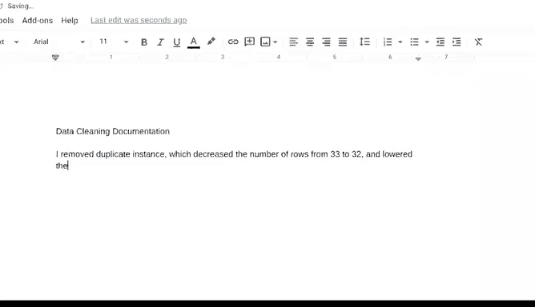

# 谷歌数据分析师第四课《从脏数据到干净数据的处理》process-data（中英字幕）deepseek翻译 - P32：32_04_03_文档化的重要性.zh_en - GPT中英字幕课程资源 - BV19m4y1J7dG

Great， you're back。Let's set the stage。 The crime is dirty data。 We've gathered the evidence。

 It's been cleaned， verified and cleaned again。Now it's time to present our evidence。

We'll retrace the steps and present our case to our peers。As we discussed earlier， data cleaning。

 verifying and reporting is a lot like crime drama。 Now， it's ourdain court。

 just like a forensic scientist testifies on the stand about the evidence。

Data analysts are counted on to present their findings after a data cleaning effort。Earlier。

 we learned how to document and track every step of the data cleaning process。

 which means we have solid information to pull from。As a quick refresher。

 documentation is the process of tracking changes， additions， deletions。

 and errors involved in a data cleaning effort。Change logs are a good example of this。

Since it's stage chronologically， it provides a real time account of every modification。

Documenting will be a huge time saver for you as a future data analyst。

It's basically a cheat sheet you can refer to if you're working with a similar data set or need to address similar errors。

While your team can view chain locks directly， stakeholders can't and have to rely on your report to know what you did。

Let's check out how we might document our data cleaning process using an example we worked with earlier。

In that example， we found that this association had two instances of the same membership for $500 in its database。

We decided to fix this manually by deleting the duplicate info。

There are plenty of ways we could go about documenting what we did。

 One common way is to create a dock listing out the steps we took and the impact they had。

 For example， first on your list would be that you removed the duplicate instance。

Which decreased the number of rows from 33 to 32。And lowered the membership total by $500。

If we were working with SQL， we could include a comment in the statement describing the reason for a change without affecting the execution of the statement。

That's something a bit more advanced， which we'll talk about later。

 Regardless of how we capture and share our change logs。

 we're setting ourselves up for success by being 100% transparent about our data cleaning。

This keeps everyone on the same page and shows project stakeholders that were accountable for effective processes。

In other words， this helps build our credibility as witnesses who can be trusted to present all the evidence accurately during testimony for dirty data。

 it's an open and shut case。