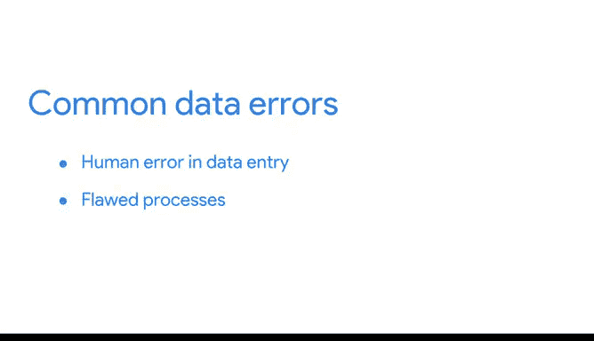

# 谷歌数据分析师第四课《从脏数据到干净数据的处理》process-data（中英字幕）deepseek翻译 - P33：33_04_04_反馈与清洗.zh_en - GPT中英字幕课程资源 - BV19m4y1J7dG

Welcome back。By now， it's safe to say that verifying。

 documenting and reporting are valuable steps in the data cleaning process。

 you have proof to give stakeholders that your data is accurate and reliable and the effort to attain it was well executed and documented。

The next step is getting feedback about the evidence and using it for good。

Which we'll cover in this video。Clean data is important to the task at hand。

 but the data cleaning process itself can reveal insights that are helpful to a business。

 The feedback we get when we report on our cleaning can transform data collection processes and ultimately。

 business development。For example， one of the biggest challenges of working with data is dealing with errors。

 Some of the most common errors involve human mistakes like mistyping or misspelling。

Fawed processes like poor design of a survey form and system issues where older systems integrate data incorrectly。

Whatever the reason， data cleaning can shine a light on the nature and severity of error generating processes。

With consistent documentation and reporting， we can uncover error patterns in data collection and entry procedures and use the feedback we get to make sure common errors aren't repeated。

Maybe we need to reprogram the way the data is collected。

Or change specific questions on their survey form。In more extreme cases。

 the feedback we get can even send us back to the drawing board to rethink expectations and possibly update quality control procedures。

For example， sometimes it's useful to schedule a meeting with the data engineer or data owner to make sure the data is brought in properly and doesn't require constant cleaning。

Once errors have been identified and addressed， stakeholders have data they can trust for decision making。

 and by reducing errors and inefficiencies in data collection。

 the company just might discover big increases to its bottom line。Congratulations。

 you now have the foundation you need to successfully verify and report on your cleaning results。

Stay tuned to keep building on your new skills。