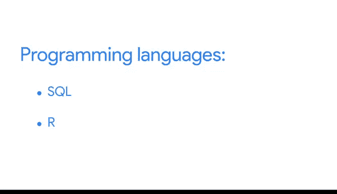

# 谷歌数据分析师第四课《从脏数据到干净数据的处理》process-data（中英字幕）deepseek翻译 - P34：34_05_01_让你的简历脱颖而出.zh_en - GPT中英字幕课程资源 - BV19m4y1J7dG

Great to see you again Building a strong resume is a great way to find success in your job hunt。😊。

You've had the chance to start building your resume。

 and now we'll take the next step by showing you how to refine your resume for data analytics jobs。

 Let's get started for data analysts， one of the most important things your resume should do is show that your clear communicator companies looking for analysts want to know that the people they hire can do the analysis。

 but also can explain it to any audience in a clear and direct way。

 your first audience as a data analyst will most likely be hiring managers and recruiters。

 So being direct and coherent in your resume will go a long way with them as well。😊。

Let's start with the summary section while you won't go into too much detail in this section about any of your work experiences。

 it's a good spot to point out if you're transitioning into a new career role。

 you might add something like transitioning from a career in the auto industry and seeking a full- time role in the field of data analytics。

One strategy you can use in your summary and throughout your resume is PAR or PAR statements PAR stands for problemble A Re。

This is a great way to help you write clearly and concisely。

So instead of saying something like was responsible for writing two blogs a month？

You'd say earned little known website over 2000 new clicks through strategic blogging。

 the website being little known is the problem。 The strategic action is the strategic blogging and the result is the 2000 new clicks。

 adding par statements to your job descriptions or skills section can help with the organization and consistency in your resume。

 They definitely helps me when I change jobs。Speaking of the skills section。

 make sure you include any skills and qualifications you've acquired through this course and on your own。

You don't need to be super technical， but talking about your experience with spreadsheets， SQL。

 Tableau， and R， which is a programming language that we'll get to later。

 will enhance your resume and your chances of getting a job。😊。

So if you're listing qualifications or skills， you might include a spot for programming languages and then list SQL in R。

 which are both a part of the Google Data Analytics certificate。

 you might even add in the top functions， packages or formulas that you're comfortable with in each it also makes sense to include skills you've acquired in spreadsheets like pivot tables。

Pivt tables， SQL， R and lots of other terms we covered here might get you noticed by hiring managers and recruiters。

But you definitely want your resume to accurately represent your skills and abilities。

 so only add these skills after you've completed the certificate once you start applying the ideas we talked about here to your resume。

 you'll be well on your way to setting yourself apart from other candidates。

And after you've completed your final course， you'll have the opportunity to complete a case study and link it on your resume。

This will be a great opportunity to show recruiters and hiring managers the skills you've learned while earning your certificate。

Before you know it， you'll have a pretty great resume that you can update quickly whenever you're searching for a data analyst job。

Nothing wrong with that。Up next， we'll talk more about adding experience to your resume， bye for now。

