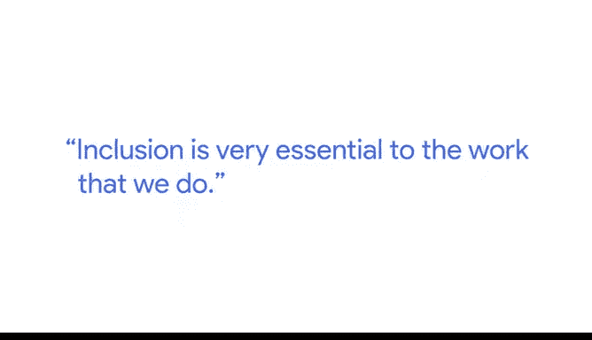
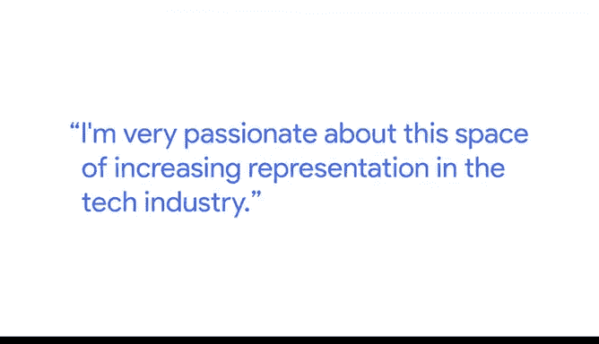
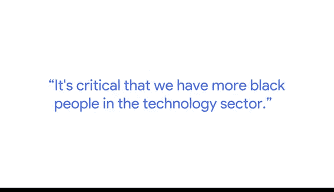

# 谷歌数据分析师第四课《从脏数据到干净数据的处理》process-data（中英字幕）deepseek翻译 - P35：35_05_02_约瑟夫：数据行业中的黑人及非裔美国人包容性.zh_en - GPT中英字幕课程资源 - BV19m4y1J7dG

Hello， my name is Joseph， I'm a People analyst at Google。As a people analyst。

 my job is to work with executives and HR business partners。

To use data to make informed people decisions， inclusion is very essential to the work that we do。

As you know， sometimes you can tell a story with data and have your own bias in it。

 so for us in this field that is very sensitive， it requires that we have a diverse set of people who have different backgrounds to have this lens of data to it。

 so being a black professional I can better tell a story about people of color that is a lot more personal to me being an analyst requires me to take data and tell a story with it on a personal standpoint I'm very passionate about this space of increasing representation in the tech industry。

For example， outside of work I run a nonprofit called Sanrofer Tech and our whole goal is essentially to help develop the next generation of black engineers who can essentially be in this field and represent our experience using data as a foundation and also technology as the parent moving factor going forward and it's critical that we have more black people in the technology sector。

As you all know the next 10， 20 years， AI and machine learning will be like just speak in English in this country or even the entire world。

 so the more we can have more black people in this field。

 the more we can represent it in the products that are being built and the more that our experiences are being influenced in every single prior that these companies do build it's definitely critical that we have more black engineers we have more black data scientists to do the analysis and also just black data analysts to help tell the story that's more inclusive of our experience as well。

 so it's definitely essentially we do have people from different backgrounds color create so we're gonna to stay in data and have the alliance to it and tell the story and make it very personal to our audience。

