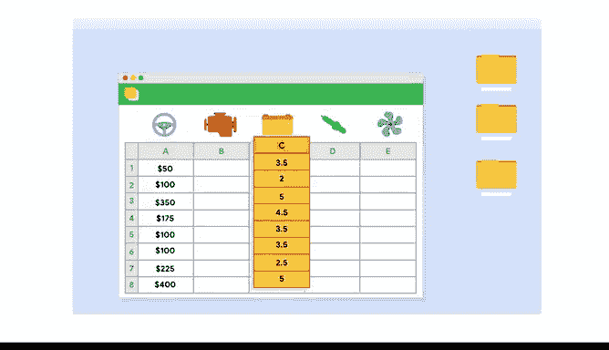

# 谷歌数据分析师第四课《从脏数据到干净数据的处理》process-data（中英字幕）deepseek翻译 - P3：03_01_03_平衡目标与数据完整性.zh_en - GPT中英字幕课程资源 - BV19m4y1J7dG

Hey there。It's good to remember to check for data integrity。😊。

It's also important to check that the data you use aligns with the business objective。

 This adds another layer to the maintenance of data integrity。

 because the data you're using might have limitations that you'll need to deal with。

 The process of matching data to business objectives can actually be pretty straightforward。

Here's a quick example。Let's say you're an analyst for a business that produces and sells auto parts。

If you need to address a question about the revenue generated by the sale of a certain part。

 then you'd pull up the revenue table from the data。If the question is about customer reviews。

 then you'd pull up the reviews table to analyze the average ratings。

 but before digging into any analysis， you'd need to consider a few limitations that might affect it。

If the data hasn't been cleaned properly， then you won't be able to use it yet。

You would need to wait until a thorough cleaning has been done。 Now。

 let's say you're trying to find how much an average customer spends。

 and you notice the same customer's data showing up in more than one row。

This is called duplicate data to fix this， you might need to change the format of the data。

 or you might need to change the way you calculate the average。Otherwise。

 it'll seem like the data is for two different people and you'll be stuck with misleading calculations。

 you might also realize there's not enough data to complete an accurate analysis。

Maybe you only have a couple months worth of sales data。

There's a slim chance you could wait for more data。

But it's more likely that you'll have to change your process or find alternate sources of data while still meeting your objective。

I like to think of a data set like a picture。 Take this picture。 What are we looking at。

Unless you're an expert traveler or know the area， it may be hard to pick out from just these two images。

Visually， it's very clear when we aren't seeing the whole picture。When you get the complete picture。

 you realize you're in London。With incomplete data。

 it's hard to see the whole picture to get a real sense of what is going on。

We sometimes trust data because if it comes to us in rows and columns。

 it seems like everything we need is there if we just query it。But that's just not true。

 I remember a time when I found out I didn't have enough data and had to find a solution。

I was working for an online retail company and was asked to figure out how to shorten customer purchase through delivery time。

😊，Faster delivery times usually lead to happier customers。 When I checked the data set。

 I found very limited tracking information。 We were missing some pretty key details so that data engineers and I created new processes to track additional information like the number of stops in a journey。

 using this data。 we reduced the time it took from purchase to delivery and saw an improvement in customer satisfaction。

 That felt pretty great。 Learn how to deal with data issues while staying focused on the objective will help set you up for success in your career as a data analyst。

😊，And your path to success continues。 Next up， you'll learn more about aligning data to objectives。

 Keep it up。😊。