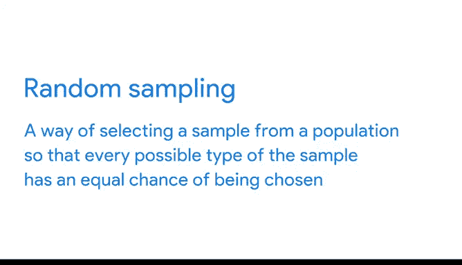

# 谷歌数据分析师第四课《从脏数据到干净数据的处理》process-data（中英字幕）deepseek翻译 - P5：05_01_03_样本量的重要性.zh_en - GPT中英字幕课程资源 - BV19m4y1J7dG

Okay， so earlier we talked about having the right kind of data to meet your business objective and the importanceinence of having the right amount of data to make sure your analysis is as accurate as possible。

You might remember that for data analysts， a population is all possible data values in a certain data set。

If you're able to use 100% of a population in your analysis， that's great。

 but sometimes collecting information about an entire population just isn't possible。

 it's too time consuming or expensive。For example， let's say a global organization wants to know more about pet owners who have cats。

You' tasked with finding out which kinds of toys cat owners in Canada prefer。

But there's millions of cat owners in Canada。 So getting data from all of them would be a huge challenge。

 Fear not， allowow me to introduce you to sample size。When you use sample size or sample。

 you use a part of a population that's representative of the population。

The goal is to get enough information from a small group within a population to make predictions or conclusions about the whole population。

The sample size helps ensure the degree to which you can be confident that your conclusions accurately represent the population。

 so for the data on cat owners。A sample size might contain data about hundreds or thousands of people。

 rather than millions。Using a sample for analysis is more cost effective and takes less time。

If done carefully and thoughtfully， you can get the same results using a sample size instead of trying to hunt down every single cat owner to find out their favorite cat toys。

There is a potential downside， though， When you only use a small sample of a population。

 it can lead to uncertainty。You can't really be 100% sure that your statistics are a complete and accurate representation of the population。

This leads to sampling bias， which we covered earlier in the program。

Sampling bias is when a sample isn't representative of the population as a whole。

This means some members of the population are being overrepresented or underrepresented。For example。

 if the survey used to collect data from cat owners， only included people with smartphones。

Then cat owners who don't have a smartphone wouldn't be represented in the data using random sampling can help address some of those issues with sampling bias。

 Random sampling is a way of selecting a sample from a population so that every possible type of the sample has an equal chance of being chosen。

Going back to our cat owners again。Using a random sample of cat owners means cat owners of every type have an equal chance of being chosen。

So cat owners who live in apartments in Ontario would have the same chance of being represented as those who live in houses in Alberta。

As a data analyst， you'll find that creating sample sizes usually takes place before you even get to the data。

 but it's still good for you to know that the data you're going to analyze is representative of the population and works with your objective。

It's also good to know what's coming up in your data journey。In the next video。

 you'll have the option to become even more comfortable with sample sizes。 See you there。😊。

