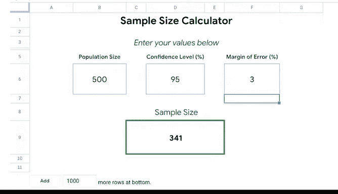

# 谷歌数据分析师第四课《从脏数据到干净数据的处理》process-data（中英字幕）deepseek翻译 - P7：07_01_03_确定最佳样本量.zh_en - GPT中英字幕课程资源 - BV19m4y1J7dG

Great to see you again in this video， we'll go into more detail about sample sizes and data integrity。

😊，If you've ever been to a store that hands out samples， you know。

 it's one of life's little pleasures for me， anyway。😊。

Those small samples are also a very smart way for businesses to learn more about their products from customers without having to give everyone a free sample。

A lot of organizations use sample size in a similar way。 They take one part of something larger。

 in this case， a sample of a population。Sometimes they'll perform complex tests on their data to see if it meets their business objectives。

We won't go into all the calculations needed to do this effectively， instead。

 we'll focus on a big picture look at the process and what it involves。As a quick reminder。

 sample size is a part of a population that is representative of the population。 For businesses。

 it's a very important tool。It can be both expensive and time consuming to analyze an entire population of data。

 so using sample size usually makes the most sense and can still lead to valid and useful findings。

There are handy calculators online that can help you find sample size。

 You need to input the confidence level， population size and margin of error。

 We've talked about population size before to build on that。

 We'll learn about confidence level and margin of error。

Knowing about these concepts will help you understand why you need them to calculate sample size。

The confidence level is the probability that your sample accurately reflects the greater population。

You can think of it the same way as confidence in anything else。

 It's how strongly you feel that you can rely on something or someone。

Having a 99% confidence level is ideal， but most industries hope for at least a 90 or 95% confidence level。

Industries like pharmaceuticals usually want a confidence level that's as high as possible when they are using a sample size。

This makes sense because they're testing medicines and need to be sure they work and are safe for everyone to use。

For other studies， organizations might just need to know that the test or survey results have them heading in the right direction。

For example， if a paint company is testing out new colors， a lower confidence level is okay。

You also want to consider the margin of error for your study。You'll learn more about this soon。

 but it basically tells you how close your sample size results are to what your results would be if you use the entire population that your sample size represents。

Think of it like this。 Let's say that the principle of a middle school approaches you with a study about students candy preferences。

They need to know an appropriate sample size and they need it now。

The school has a student population of 500， and they're asking for a confidence level of 95% and a margin of error of 5%。

We've set up a calculator in a spreadsheet， but you can also easily find this type of calculator by searching sample size calculator on their internet。

 and just like those calculators， our spreadsheet calculator doesn't show any of the more complex calculations for figuring out sample size。

So all we need to do is input the numbers for our population， confidence level and margin of error。

 and when we type 500 for our population size。And 95 for our confidence level percentage。

And five for our margin of error percentage。The result is about 218。That means for this study。

 an appropriate sample size would be 218， so if we surveyed 218 students and found that 55% of them preferred chocolate。

 then we could be pretty confident that would be true of all 500 students。

218 is the minimum number of people we need to survey based on our criteria of a 95% confidence level and a 5% margin error。

And in case you're wondering， the confidence level and margin of error don't have to add up to 100%。

 They're independent of each other。 So let's say we change our margin of error。From 5%。To3%。

Then we find that our sample size would need to be larger， about 341 instead of 218。

 to make the results of the study more representative of the population。

Feel free to practice with an online calculator knowing sample size and how to find it will help you when you work with data。

 and we've got more useful knowledge coming your way， including learning about margin error。

 See you soon。