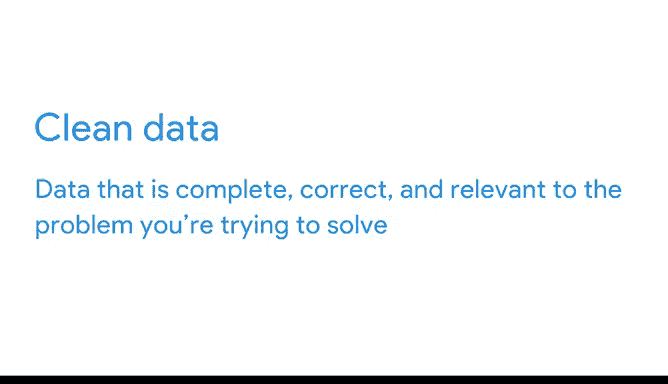

# 谷歌数据分析师第四课《从脏数据到干净数据的处理》process-data（中英字幕）deepseek翻译 - P9：09_02_01_清理数据.zh_en - GPT中英字幕课程资源 - BV19m4y1J7dG

Can you guess what inaccurate or bad data cost businesses every year？Thousands of dollars， millions。

 billions。Well， according to IBM， the yearly cost of poor quality data is $3。

1 trillion in the US alone。That's a lot of zeros。Now。

 can you guess the number one cause of poor quality data？

It's not a new system implementation or a computer technical glitch。

The most common factor is actually human error。Here's a spreadsheet from a law office。

 it shows customers the legal services they bought。The service order number。How much they paid。

And the payment method。Dirty data can be the result of someone typing in a piece of data incorrectly。

Inconsistent formatting。Blanlink fields。Or the same piece of data being entered more than once。

 which causes duplicates。Dirty data is data that's incomplete， incorrect。

 or irrelevant to the problem you're trying to solve。When you work with 30 data。

 you can't be sure that your results are correct。 In fact， you can pretty much， bet they won't be。

Earlier， you learned that data integrity is critical to reliable data analytics results。

And clean data helps you achieve data integrity。 Clean data is data that's complete， correct。

 and relevant to the problem you're trying to solve。

When you work with clean data， you'll find that your projects go much more smoothly。

I remember the first time I witnessed firsthand how important clean data really is。

I had just started using SQL and I thought it worth like magic。

I could have the computer sum up millions of numbers， saving me tons of time and effort。

But I quickly discovered that only works when the data is clean。

If there was even one accidental letter in a column that should only have numbers。

 the computer wouldn't know what to do。 So we'd throw an error。 and suddenly I was stuck。

And there's no way I can add up millions in the numbers by myself。

So I had to clean up that data to make it work。The good news is that there's plenty of effective processes and tools to help you do that。

Coming up， you'll gain the skills and knowledge you need to make sure the data you work with is always clean。

Along the way， we'll dig deeper into the difference between clean and dirty data and why clean data is so important we'll also talk about different ways to clean your data and common problems to look for during the process。

Ready to start， let's do it。