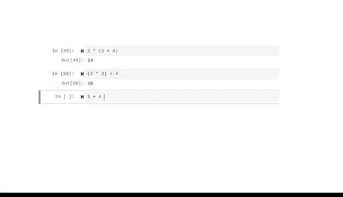

# 谷歌高阶数据分析 2：《Python入门》get-started-with-python（中英双字） - P10：10_01_02_创建精确的变量名.zh_en - GPT中英字幕课程资源 - BV1Jm4y177BW

Python has certain spelling or grammatical rules to follow。 just like any other language。

 in programming， we call these rules naming conventions and naming restrictions。

 If you completed the Google data Analytic certificate。

 you might remember that naming conventions are consistent guidelines that describe the content。

 creation date and version of a file in its name。 Naming restrictions are rules built into the syntax of the language itself that must be followed。

 And Python， there are some important naming conventions to keep in mind。

 One of these is to avoid keywords。A key word is a special word that is reserved for a specific purpose。

 and that can only be used for that purpose。You've already encountered some keywords， such as for。

 in， if and else。 There are others， too， which you'll learn about soon。

 Keyword should never be used when naming variables。Thankfully。

 you don't have to worry about accidentally using a keyword。 First of all。

 keywords will appear in a special color and most coding environments。

 So a good rule to follow is that if your're naming a variable and the name changes color。

 don't use that name。😊，And if you're thinking， but I like colorful variable names。

 and you try to assign a value to a keyword anyway。

 the computer will say not so fast and throw an error。Python will let you make spelling mistakes。

 but it won't let you use a keyword for a variable name。By the way。

Throw an error is a common phrase that every coder knows only too well。

 It just means that the computer returns an error and your code doesn't successfully run。 Also。

 some names are reserved for existing functions。 For example， print and STR。

 So you should also avoid using names of existing functions to sum up a big thing to keep in mind regarding variable naming conventions is that you don't want to use reserved keywords or functions。

Precision is essential in programming。This is why there are naming restrictions for variables。

 For instance， variables can only include letters， numbers and underscores。

This means you can't use spaces， tabs or special characters， such as the dollar sign or ampersand。

 Another rule to keep in mind is that while variable names can contain numbers。

 they must start with a letter or underscore。 Also， Python is case sensitive。

 which means capitalization matters。 Lastly， variable names cannot include parentheses。

 This is because parentheses have other uses in Python。

Let's review some examples of effective and ineffective variable names。

 Any underscore A underscore variable is a valid variable name。

Any underscore a underscore variable underscore2 is also good。However。

 one underscore is underscore a underscore number would be invalid because variable names must start with a letter or underscore apples underscore ampersan underscore oranges is also invalid because it uses the special character Ampersan。

 you do have some flexibility when naming your variables。 Since these are references you create。

 these conventions and restrictions just help make them consistent and useful。 Okay， Now。

 let's go back to parentheses to understand more about how these function in Python。

 When doing calculations， the rules for parentheses follow the mathematical order of operations。

 For instance， if we input two times3 plus4 in parentheses， Python will read3 plus4 first。

 because if following the order of operations。This is equal to 14。

 but two times 3 in parentheses plus 4 equals 10。 That's because the operation within parentheses will always be completed first。

By the way， if we don't use any parentheses， Python will follow the standard mathematical order of operations。

Naming conventions and restrictions for variables help maintain consistency and usefulness as you continue to use Python for a variety of activities。

 A key part of working with Python as a data analytics professional is being able to effectively name your variables to create meaningful code soon will'll explore conversions and data types By for now。

😊。