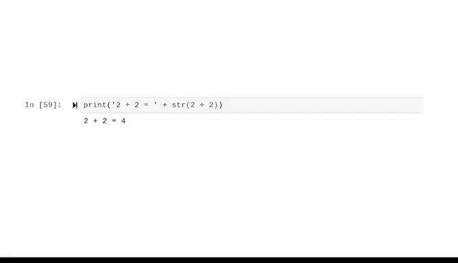

# 谷歌高阶数据分析 2：《Python入门》get-started-with-python（中英双字） - P11：11_01_04_数据类型与转换.zh_en - GPT中英字幕课程资源 - BV1Jm4y177BW

Previously， you learned about variables and how to name them。

 You learn that variables point to values that are stored in the computer's memory。In other words。

 the variables are like containers and the values they store are their contents。

Now you're going to learn more about the values that your variables can contain。As you've learned。

 text written between quotes and Python is called a string。Programs need to manipulate data。

 which can come in a lot of different forms or types。These data types include strings， integers。

 and floats。First， a string is a sequence of characters and punctuation that contains textual information。

Strings are instantiated with single or double quotation marks， or the string function。

This is an immutable data type， which means the values can never be altered or updated。

An integer is a data type used to represent whole numbers without fractions。

And float data types represent numbers that contain decimals。

Most computers understand when you tell them to add to integers。Or add two strings。

But generally speaking， computers don't know how to work with different data types。

 If you try to mix different data types， it can sometimes throw an error。As always。

 the computer tells us the cause of the error。 It's like a little clue to help you improve your programming skills。

Read the errors carefully。 understand what they're trying to tell you and use that knowledge to fix the mistake。

In this example， the last line of the error message says we've encountered something called a type error。

7 is being read as an integer and 8 is being read as a string because of the quotation marks。

 No wonder we had an error。You can't add seven to a word。As a data professional。

 you'll often need to aggregate a lot of data of different types。

 This will require converting the various types so they can be combined successfully。

There's an effective method for doing this， but first。

 it's important to know what you're working with。Python offers a helpful way to identify data types with the type function。

You can use the type function to have the computer tell you the data type。For instance。

 the type function here tells us that a belongs to the STR class， which is short for string。

 The number two belongs to the INT class or integer， and 2。5 belongs to the float class。

As a reminder， a class is an object's data type， the class bundles data and functionality together。

Now let's find out how to combine these different data types。

There are two ways to convert data in Python。First is implicit conversion。

Implicit conversion automatically converts one data type to another without user involvement。

Here's an example。In arithmetic operations involving both integers and floats。

 The interpreter works in the background and converts integers to floats。

 You don't have to specify anything in your code to do this。However。

 if you want to convert numerical values to strings， you will need to do an explicit conversion。

Explicit conversion is where users convert the data type of an object to a required data type。

We use the predefined functions， INT， Fat and STR。This is sometimes called typecasting because the user casts or changes the data type。

Let's use the STR function inside the string we want to have interpreted as output。

And now the output of this calculation will be stored as a string。

Great work。You'll continue exploring data types and seeking solutions to errors throughout this program。

Debugging or figuring out what's wrong when your code won't work is a really useful skill for any data professional。

Also， as a final tip， all of us in the profession， even experienced data professionals and code developers search for answers online when we encounter an error This is a common strategy and a huge time saver。

Always look to the data community for answers and inspiration。

