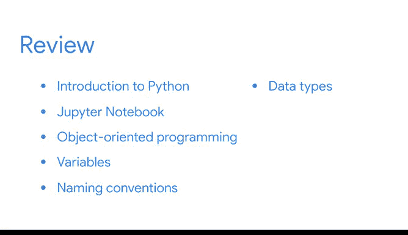

# 谷歌高阶数据分析 2：《Python入门》get-started-with-python（中英双字） - P12：12_01_01_总结_1.zh_en - GPT中英字幕课程资源 - BV1Jm4y177BW

We have come to the end of the first section of the Python course。

 You've developed a lot of new Python skills already。 Well done。 along the way。

 you've discovered that Python is a powerful tool for data professionals and learned how Python can help you work with your data quickly and efficiently。

 We began with a general introduction to the Python programming language and explored how data professionals use Python to power the data analysis。

 Then we discussed Jupyter notebooks。 You learned about the main features of Jupyter notebooks and how to write Python code in the notebook environment。

😊，Next， you've explored the benefits of object oriented programming for data professionals and learned about its basic concepts。

After that， we focused on working with variables。 You learn how to assign specific values to variables and effectively store and label your data。

We also review the standard naming conventions for variables。

 you learned useful guidelines for making your code clear， precise and consistent。Finally。

 we explored different data types in Python， such as integers， floats and strings。

 You learned how to convert and combine data types to organize your data。😊。

Coming up， you have a graded assessment。To prepare。

 review the reading that lists all the new terms you've learned and feel free to revisit videos。

 readings and other resources that cover key concepts。 Congratulations on your progress so far。

 and I'll meet you again soon。😊。