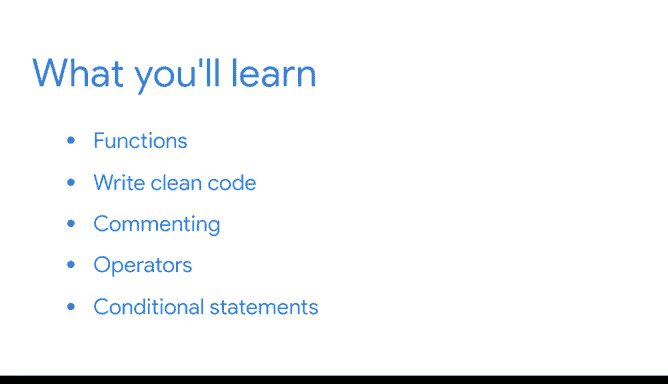

# 谷歌高阶数据分析 2：《Python入门》get-started-with-python（中英双字） - P13：13_02_01_欢迎来到模块2.zh_en - GPT中英字幕课程资源 - BV1Jm4y177BW

Welcome back。 I'm excited to continue our learning journey together。😊。

I really enjoyed exploring the basics of Python programming with you。

 You learned that Python is a powerful tool for data professionals and lets you analyze data with speed。

 accuracy and efficiency。 You now know how to use variables and data types to store and organize your data and have already started writing your own Python code。

 In this course， we'll continue to build on your foundation of Python knowledge。

 By the end of the course， you'll be able to write statements in Python code to perform multistep operations on your data。

😊，You'll also learn how to write clean， readable code that can be easily understood and reused by other data professionals。

 Being able to collaborate with teammates is one of the most important skills for a data professional。

 and writing clean code is a great way to collaborate with your teammates and help your team achieve its goals。

 Work with clean code helps your team work faster， Com more effectively and produce better results。

 We'll start with functions， or reusable chunks of code that let you perform specific tasks。

 functions are like the verbs or action words of a programming language。

 You can call on a function at any time to help you perform useful actions on your data。

 such as sorting， classifying， summarizing and much more。

 Then we'll discuss how to write clean code that can be easily understood by your teammates and collaborators。

 You'll learn about two important elements of writing clean code， reusability and modularity both。😊。

Of these practices， speed up project development and help data professionals focus on core business needs and avoid spending time doing rework。

 After that， we'll examine another key aspect of writing clean code。

 commentmenting commentmenting is a useful practice because it helps you consider your thought process while documenting your workflow for teammates。

 using comments to describe the component parts of a problem helps you solve it in clear。

 simple steps。 Next， we'll discuss how to use operators to compare values。

 We'll review two types of operators， Comparators and logical operators。

 comparators such as greater than or less than allow you to compare two values。

 logical operators such as and and or let you connect multiple statements together and perform more complex comparisons。

 Data professionals use operators to analyze and make decisions about their data。 Lastly。😊。

Consider conditional statements， which tell the computer how to make decisions based on your instructions。

You'll learn how to write ifel and else， if statements。

 Data professionals use conditional statements to structure complex operations and to perform all kinds of practical tasks。

 such as binning data and organizing files。 Conditional statements make your Python code more flexible and powerful。

 When you're ready， I'll meet you in the next video。😊。

