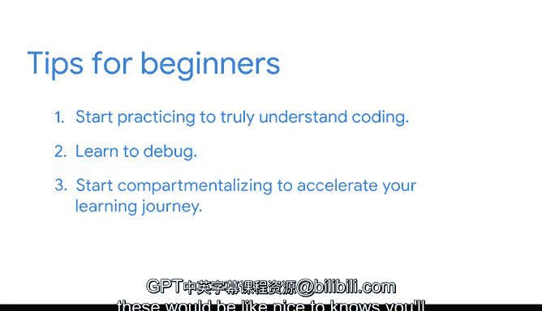

# 谷歌高阶数据分析 2：《Python入门》get-started-with-python（中英双字） - P14：14_02_02_拉蒂法-应对编程学习挑战的技巧.zh_en - GPT中英字幕课程资源 - BV1Jm4y177BW

🎼Hi， my name iss Laiffa。 I'm a customer engineer here at Google Cloud。

 My specialty is data analytics。 Essential， I'm taking what a customer already has on another cloud provider or in their data centers and figuring out how to translate that onto our cloud platform When I was a kid。

 I had two dream jobs。 One was to be a secretary and the other one was to be a waitress。

 I did both of those things。 I enjoyed them immensely。

 One of the biggest lessons I took away from my time waitressing is to just face the issue head on。

 I was a very timid person when I started waitressing。

 And so if like something was wrong with somebody's order。

 I would just hide in the kitchen until like they could make a new one and then pretend like everything was fine the whole time。

 That didn't always go my way， as you could imagine， it actually would just make people matter。

 And so from that I took away just learning to and make your mistakes。

 facing it head on and not being afraid to talk it through with somebody。

 Well learning Python was a little difficult。 A lot of the first issues I had was with setting up Python and the environment and picking IDs。

😊，I don't know if you've ever played a video game， but you can spend so much time on that initial screen just like character selecting。

 or there's so much time。 you can just get bogged down， picking like these small。

 minute things before you get to the meat and potatoes。

 The way I overcame those challenges was one committing to just starting。

 I realize it's really powerful to just stay。 you're going spend X amount of time doing this。

 And even if you made no progress， you can at least go home or go to bed that night saying， like。😊。

I did what it could。 And if that wasn't enough， it just wasn't enough。

 I really took the time to understand how to read stackck overflow， right？

 I was super frustrated with it when I first started coding。

 but that was because I just wanted to like copy paste the code into the console and just like magically have it work for me。

 or you know， I was trying to blame everything on the version of Python I was running or the package version I was running。

 And that just wasn't the case。 So just learning to slow down and actually understand what it's saying and how this translates to the error I'm running into or the issue I'm running into versus just trying to brute force my way almost to the next topic or the next question was really helpful on my first team。

 which was a purely sales team。 We were tasked with creating these business intelligence reports for like 2300 different customers or potential customers。

 I think my manager at the time calculated it out。 And we would have all had to put in 50 hours a week for the next three weeks to complete that task。

 That's not ideal。😊，Right nobody wants to spend like eight hours。

 eight to10 hours a day making intelligence reports， but with my coding knowledge。

 I was able to automate the creation of those business reports and create the 2300 within an hour and a half and it just felt good to know like I was capable of it The number one tip I can give people looking to start coding you are going to watch a ton of videos here a ton of information somebody's going to talk to you about optimization how to write the best code but until you've actually done it you just won't understand all the rigmar role involved in coding and debugging which brings me to my other tip I would say learn to debug and then if I could give a third tip it would be to learn to just deal with the noise if you can start compartmentalizing and like this is what I absolutely have to know to get started and to move forward and these would be like nice to know you'll really accelerate your learning journey。

