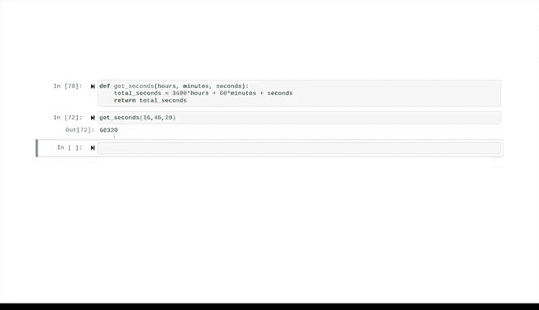
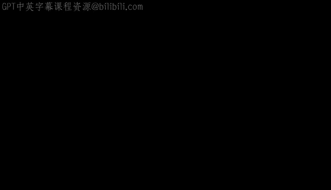

# 谷歌高阶数据分析 2：《Python入门》get-started-with-python（中英双字） - P15：15_02_03_定义函数与返回值.zh_en - GPT中英字幕课程资源 - BV1Jm4y177BW

Recently， we've been exploring variables， expressions and data types。 And this video。

 we'll consider another important component of programming and Python functions。

 A function is a body of reusable code for performing specific processes or tasks。😊。

We' have come across a few built in Python functions so far。 For instance。

 the print function writes text on the screen。The type function tells us the data type contained within a variable。

And the SR function converts an object into a string。 Note that in previous version of Python。

 print was handled as a statement and did not use parentheses。 But for Python 3。

 the print syntax is a function and requires parentheses。

 even when there are no arguments used and the parentheses are empty。 Okay。

 so we know that Python has many built in functions。

 But if we want to tell a computer to do other things， particular to our own use cases。

 It's important to know how to define our own functions。 to define a function。

 we use the key word de at the start of the function block。

 You've encountered the defined function once before in a previous video。

 But let's consider another example。 when defining a new function always begin with the deaf key word。

The name of the function comes next。 Let's call it greeting。After that。

 we have the function arguments also known as parameters。

 A functionss arguments are always written in parentheses。

 The arguments are the things you give to the function to modify in some way。

 You can call them anything you want。 Whatever we call them here when we define the function is how we'll have to refer to them below in the functions body。

 In this example， our function will have just one parameter name When we're done defining the arguments。

 close the parentheses， put a colon at the end and hit enter to get to a new line。Now。

 we can write the body of the function。 This is where we say what we want the function to actually do。

 Note how the body is automatically indented to the right。In Python， lines of code are hierarchical。

 Any line that is indented pertains specifically to the less indented code that precedes it。

We can add as many lines as we'd like to the body of the function。

 but each line must be indented to the right here， it's indented for spaces。

 You can use however many spaces you like as long as your're consistent。 However。

 four spaces is usually the preferred way， because it makes code more readable。

 Our greeting function will take a name and output a greeting using that name。

 We' have the function print welcome。 The person's name。😊，And then on a new line， print。

 you are part of the team。To finish defining the function， simply unindent the next line of code。Now。

 we can call the function using the word greeting inside the parentheses。 We'll type the name。

 Rebecca。 Then we'll run the cell。Of course， functions can do a lot more than print messages。

 This is just one simple example of defining your own function。 Next。

 let's consider how to get values out of a function。 This is where return values can be used。

 returnturn is a reserved keyword in Python that makes a function do work to produce new results。

 But instead of printing the results。 The function saves them for later use。

 Let's define a new function that accepts two arguments。 The base and height of the triangle。

 and returns the area of the triangle。 The area is calculated as base times height divided by two。

 We use the key word return to tell Python that this is the value that we want to come out of the function。

 Instead of printing， return lets us store this value in a variable。

 So suppose we have two triangles and want to add the sum of both areas。 Here's what we would do。

 First， calculate the two areas separately。😊，Storing each value in its own named variable。

Then add the two areas together， assigning the results to a variable called total area。

If we call this variable， the Jupiter notebook returns its value， but we don't have to call it。

We could continue writing code if we want。 This demonstrates the power of the return statement。

 It enables us to combine function calls with other operations， which makes the code reusable。

 Reusability involves defining code once and using it many times without having to rewrite it。

 There's more information on reusability soon。 But for now。

 just understand that reusing something takes a lot less time and effort than recreating it every time。

😊，Let's do one more。 Here is a function called get seconds。 This function takes hours。

 minutes and seconds as inputs and returns the total number of seconds those inputs represent。

In the first line， we begin with the key word de and name the function get seconds。

In the parentheses， we give it three parameters， hours， minutes and seconds。

 The next line performs a computation that calculates the total number of seconds and assigns that value to a variable called total seconds。

 The third and final line is the return statement that returns the value of total seconds。

 When we call the function， we have to give it three arguments。 hours， minutes and seconds。

 We'll use 16 hours，45 minutes and 20 seconds。 And theres our result，60320 seconds。 Now。

 you understand more about functions and how to use the return keyword to save the results of a function for later output。

 code reuse is a key element of Python that you will continue to appreciate as a data analytics professional。

 Your data tool box is growing and growing， and there's more on the way。😊。

