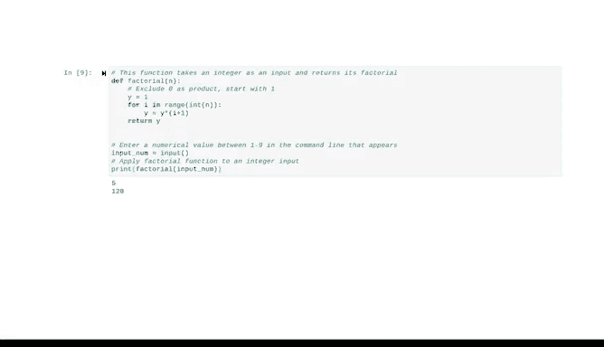

# 谷歌高阶数据分析 2：《Python入门》get-started-with-python（中英双字） - P16：16_02_04_编写整洁代码.zh_en - GPT中英字幕课程资源 - BV1Jm4y177BW

In the early years of software development， it was common for developers to write each bit of code themselves。

Now we know it's much more efficient to reuse code that others have written and put in online code repositories。

Or we can develop modular code， which we'll learn about in this video。

 Both of these practices speed up development and help data professionals focus on using code logic to meet business needs instead of doing rework。

 As we've discussed， reusability involves defining code once and using it many times without having to rewrite it。

😊，Consider this example。 This script uses the length function， which returns the length of an object。

 In this case， it's the number of characters in the string。

Then it uses that length to calculate a number， which we're calling the lucky number。Finally。

 it prints a message with the name and the number， each time we want to perform the calculation。

 we change the values of the variables and write the formula。

Notice how there are exactly two lines that are the same in the first and second part of the code。

When you find code duplication in your scripts， it's a good idea to check if you can clean things up by using a function。

 Let's rewrite this code， creating a function to group all the duplicated code into just one line。😊。

This updated script gives us the exact same results as the original one。

 but it's cleaner and easier to understand。 Best of all， it's now reusable。

We can execute the code inside the lucky number function as many times as we need to by just calling it with a different name。

 because of its modular nature， Python is well suited to making code reusable。

 modularity is the ability to write code and separate components that work together and that can be reused for other programs。

😊，Moularity is closely related to reusability because it lets you reuse blocks in sections of code。

Reusing code blocks can help you more effectively collaborate with data engineers on larger projects so that they don't have to start their code from the beginning。

Here's an example。These variable names don't really tell us anything about what this code is trying to do。

 We can run it。 And， yes， it does something， but it was pretty difficult to read and understand that code。

So let's try to make this code clear for other users。

Refactoring is the process of restructuring code while maintaining its original functionality。

This is a part of creating self documenting code。Self documenting code is code written in a way that is readable and makes its purpose clear。

This involves everything from selecting your variable names to writing clear， concise expressions。

Comments are a helpful supplemental explanation of the code。

 When your computer registers the hashtag character in front of the comment line。

 it knows to ignore everything that comes after that character on that line。

So let's refactor this code to make itself documenting。Now。

 the intent and construction of a code is more clear。

It's also broken up into functions and commented sections commentmenting is a useful practice because it helps you think about your process while documenting your workflow for other collaborators。

😊，Although messy code doesn't necessarily cause a script to fail the cleaner the code。

 the more useful it is for the rest of your team， your colleagues will appreciate clean code because they can understand and reuse it to save themselves both time and effort。

 Plus， code reuse and modularity reduces errors。 enhances teamwork and builds trust。

