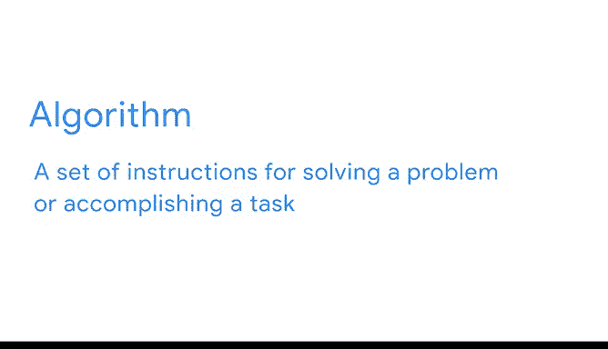
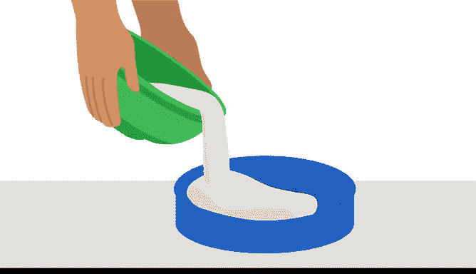
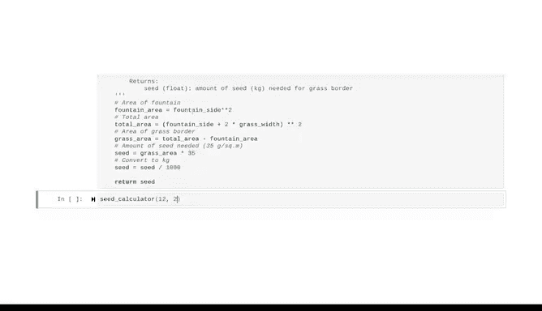

# 谷歌高阶数据分析 2：《Python入门》get-started-with-python（中英双字） - P17：17_02_05_使用注释构建代码框架.zh_en - GPT中英字幕课程资源 - BV1Jm4y177BW

Previously， you learned about writing clean code。 In that video。

 I mentioned that lines of code that began with a hashtag don't get executed。

 and instead serve as comments for the human reading the code。😊，In this video。

 you'll learn more about commenting and why it's such an important part of writing good code。

 Build good coding habits will enable you to use Python effectively when using data to inform solutions to business problems。

 Let's begin with algorithms， which will help you learn to think like a programmer and translate instructions and Python code。

😊，In programming languages， an algorithm is a set of instructions for solving a problem or accomplishing a task。

One everyday example of an algorithm is a recipe consisting of specific instructions for baking bread。

First， you preheat the oven to 425 degrees Fren。 Then you mix  two cups of flour，3 eggs。

2 cups of water， and a teaspoon of yeast in a bowl using an electric hand mixer。

 Then you let the dough rise for an hour。 After that。

 you transfer the dough from the bowl to the baking pan。 Finally。

 you insert the baking pan in the oven。😊。

In a similar way， every computerized device is given instructions in the form of algorithms as hardware or software based routines to perform its functions。

 That's why it's important to know how to explain things logically to the computer。

 This is what it means to think algorithmically。 You've already started to think this way。

 because you've learned about functions and functions are algorithms。 as your coding skills develop。

 You'll be able to write longer and more complex functions。😊。

The best way to approach writing a new function is to break it into small， simple pieces。

 beginning with the comments， outlining the comments and steps before you even write the code helps you to better understand the problem。

 Let's review an example。 Suppose we have a square fountain。

And we want to plant grass in our border around that square。

 Let's write a function to calculate the amount of grass seed we'll need。

 if we know the length of the side of the fountain and the width of the grass border。😊，As always。

 begin with the deaf key word。Will name the function seed calculator。

 Its parameters will be the two things we know。 The fountain side length and the width of the grass border。

 Now， we're right the body of the function， breaking it into small steps that will outline with comets。

 First， we'll find the area of the fountain。 Next， we'll calculate the total area of the square and the grass border combined from these。

 we can derive the area of just the grass border by subtracting one from the other。

 Then we'll calculate the amount of seed we'll need， which is 35 G per square meter。😊。

We'll have to convert that to kilograms because that's what we said the function would output。

 And finally， we have the return statement。So let's review what we've done。

We use comments to create a logical scaffolding before writing any code in the body of this function。

 In other words， we use comments to break down the thought process that outlines each segment of code that we need in order to meet our goal。

 The only thing left for us to do is fill it in with code， step by step。

We can get the total area by finding the length of one side of the larger outer square and squaring it。

The length of the large square is equal to the width of the border times 2 plus the length of the side of the fountain。

So we'll code that as total area equals fountain side plus2 times the grass width。

And we'll take that whole expression， and square it。

The area of the grass border is equal to the total area minus the fountain area。

Then the amount of seed we'll need is the grass area times 35 grams per square meter。Next。

 we convert grams per square meter to kilograms per square meter by dividing by 1000。

And return our seed variable。We're almost done。 There's another important part of writing functions that are user friendly and easy to understand。

 It's called a document string or dock string， as it's most commonly referred to。

 The dock string is a string at the beginning of a function body that summarizes the functions behavior and explains its arguments and return values。

 A functions dock string begins and ends with three quotation marks。

 They can be single quotes or double quotes。 First， we write what the function does。

 It takes the form of a command and ends in a period。

 like calculate the number of kilograms of grass seed needed for a border around a square fountain。

Next， we'll describe the functions parameters Ours has two， we have fountain side。

 which is numerical data that represents the length of one side of the fountain in meters。

Then we have grass width， which is also numerical data。

 and it represents the width of the grass border in meters。Lastly。

 we'll describe what the function returns。This function returns the seed variable。

 which is a float that indicates the amount of grass seed needed for the border in kilograms。Great。

 we have a function that performs a complex task and can be used as many times as we need。

 Uing comments to break up the parts of the problem allowed us to solve it in clear， simple steps。

 best of all， other people can use this code and understand exactly what it's doing。

 Because we've written a dock stringing and concise comments。

 So how much see do we need if our Funland is a square。

 That's 12 m long on a side and we want a 2 m border of grass around it。😊。

3。92 kilograms。To recap， comments act as a scaffolding that breaks up your code into manageable pieces。

Along with the function Doc string， they help you and others understand and use your code。

 It's important for data professionals to get in the habit of writing well documented code。

 It's a little more work up front， but you'll thank yourself later。 and so will your colleagues。

