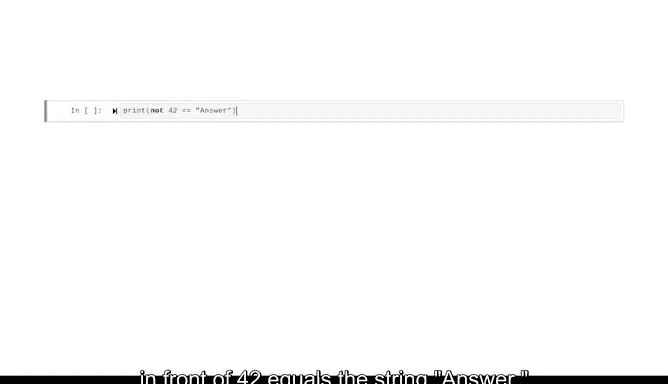

# 谷歌高阶数据分析 2：《Python入门》get-started-with-python（中英双字） - P18：18_02_01_使用运算符进行比较.zh_en - GPT中英字幕课程资源 - BV1Jm4y177BW

You've learned about data types like integer， stringing， and Fat。Another data type is Boolean data。

This is data that has only two possible values， usually true or false。

The word Boolean comes from George Bull， a 19th century English mathematician。

Every time you compare things in Python， the result is boolean type data。

Data professionals use Boolean data every day to control logical flows in their code。

In previous lessons， you discovered how Python can be used like a calculator for basic arithmetic。

Now we'll find out how to use the power of Python to compare values with comparators and operators。

Comparators are operators that compare two values and produce Boolean values。All right。

 now let's consider an example。If we print 10 is greater than one， a comparator produces the result。

 a Boolean value， true。There are six comparators in Python。

 They let us confirm whether something is greater than greater than or equal to less than。

 less than or equal to equal to or not equal to something else。

Data professionals take the results of comparator expressions and use them to make decisions about data assigned to these descriptions。

Here's an example， cat is not in fact， equal to dog。So it produces the Boolean value false。 Now。

 let's pair an exclamation mark and an equal sign， which is the not equals comparator。

 So the comparator checks that one isn't equal to two and produces the boolean value of true。

 As we've learned， the plus operator doesn't work between integers and strings。

 So let's consider what will happen if we try to compare an integer and a string。Yep。

 another type error。The good news is that Python also has a set of logical operators。

 Lo operators or operators that connect multiple statements together and perform more complex comparisons。

😊，Examples of these are the words and or and not。These operators allow you to connect multiple statements together and perform more complex comparisons。

The and operator needs both expressions to be true to return a true result。Here。

 we're comparing strings。 When used on strings of text。

 comparators evaluate the first letter of each string with a being least and Z being greatest。😊。

If two strings have the same first letter， the second letter will be compared。 In this case。

 the Y in yellow is greater than the C insya。 But the B in brown doesn't come after the M and magenta。

 So this means that the first statement is true。 But the second one isn't true。

 So if only part of an expression is true。The result of the whole and statement is false。

Or statements are the opposite。 If we use the or operator。

 the expression will be true if either of the expressions are true and false only when both expressions are false。

Try it out， print this code。Open parentheses 25， the greater than comparator 50， the or operator 1。

The not equal comparator 2。Close parentheses。25 is definitely not greater than 50。

 but one is not equal to2。So in the end， the whole expression is true。Now。

 the knot operator inverts the value of the expression that follows it。If it's true。

 it becomes false。 If it's false， it becomes true。Because there is a not statement in front of 42 equals the string answer。

 the result is true。

Comparators and logical operators are very useful in the data field because they make it possible to write much more complex code。

Later， I'll be back to demonstrate some examples of these expressions。

 Keep practicing and reviewing comparators and operators。 I'll be with you again， soon。

