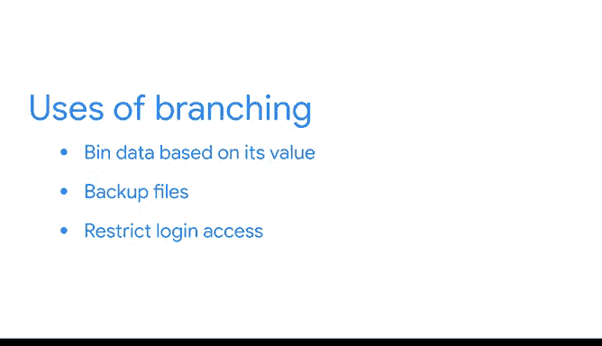

# 谷歌高阶数据分析 2：《Python入门》get-started-with-python（中英双字） - P19：19_02_03_使用if-elif-else语句进行决策.zh_en - GPT中英字幕课程资源 - BV1Jm4y177BW

Now that we know about variables， expressions， functions， data types， comparators。

 and logical operators， we can perform exciting actions in our scripts based on their values using branching。

 which is exactly what we'll learn about in this video。

Branching describes the ability of a program to alter its execution sequence。

 This is a key component to writing useful scripts。

Branching uses if statements based on certain conditions。

If is a reserved keyword that sets up the condition in Python。

If statements also known as conditional statements are just like using the word if in everyday life。

For example， if it's before noon， you'll greet someone by saying good morning rather than good afternoon or good evening。

If it's raining outside， you might choose to carry an umbrella。 And if it's snowing。

 you'll probably wear a jacket。Heres an example of this concept in a business context。 At a company。

 new employees can choose their username。 However， the user names need to fit a given set of guidelines。

Maybe a valid username requires at least eight characters。As a data professional at this business。

 you're tasked with writing a program that will tell the user if their choices are valid or not。

To accomplish this task， we'll write a function。The goal is to define the function so that it generates a username hint using an if statement。

As a reminder， the built in L function will return the length of an object。

 and that can be paired with the less than comparator to identify user names that don't meet the criteria。

Great， now your function checks whether the length of the username is less than 8。If it is。

 the function prints a message saying that the username is invalid。Let's review our if statement。

We write the keyword if， followed by the condition that we want to check for， followed by a colon。

After that， we have the body of the if block， which is indented further to the right。

Here's a very important point。The body of the if block will only execute when the condition evaluates to true。

 Otherwise， it does not execute。What this means is if you run an if block and the argument conditions are not met。

 the indented code beneath it gets ignored。The if statement is a useful construct in Python syntax。

But what if we could extend it to make it even more powerful？

What if we want the computer to do something else？Else is a reserved key word that executes when preceding conditions evaluate as false。

The else statement lets us set a piece of code to run only when the condition of the if statement is false。

Here's an everyday example， if you're hungry， you eat。But if you're not hungry。

 if that concept is false， then you'll do something else。

 Maybe you'll make another choice and take a nap。Think about our company username example。

 Maybe now we want to print a message when a username is valid。

 The function can now go in different directions， depending on the length of the username。

If the username is not long enough， a message indicates that it's invalid。

But if the function verifies that the username is long enough。

 it will print a message saying that it's valid， which is dictated by the AlL statement。

Notice the structure of the function right now。 The if statement is indented in the body of the function。

 and the action we want to happen。 if that statement is true， is indented beneath it。

We could write as many lines as we want here。 And as long as they're all indented beneath the if statement。

 though all execute when that if statement is true。 Then we have the else statement。

 Note that it's unindented to the same level as the if statement。

And if statement in its corresponding else statement are always written at the same level。

Beneath the out statement， we indent once more to indicate that this is what must execute when the if statement is not true。

Sometimes you don't need to add an else statement because that logic is already built into the code。

 Let's explore a new operator that will help with this。 We're going to use a new operator， The modo。

 represented by the percentage sign。 The modo is an operator that returns the remainder when one number is divided by another。

The division between integers yields two results， which are both integers。

 the quotient and the remainder。So for an integer division between5 and 2， the quotient is 2。

 and the remainder is one。For an integer division between 11 and 3， the quotient is 3。

 and the remainder is 2。Even numbers are all multiples of two。

 which means the remainder of the interteger division between an even number and 2 is always going to be 0。

So the modular division of 10 by 2 is zero。Let's review an example。

This function checks whether a number is even by dividing it by 2 and checking that the remainder is 0 using the modo operator。

If the remainder is0， the function will return true。Now， here's the interesting part。

 You can put an L statement here。 That would work， but it's not strictly necessary because of the way if statements work。

 Remember， when the if statement evaluates to true， the code indented beneath it will execute。

But when the if statement evaluates apho， nothing indented beneath it will execute。

The code will then continue running until it gets to the end of the function。

Let's try entering the odd number 19， using the is even function we defined。

 The function returned false because 19 modular 2 does not evaluate to true。

 So the code indented beneath the if statement doesn't execute。

 And then the function continues running。In this case。

 the only remaining code in the function is returnturn false， so that's what it does。

 it returns false。At first， you might prefer to include the outstate in such instances。

 and that's okay。 It's important to know that both ways are correct。But keep in mind。

 this technique can only be used when returning a value inside the if statement。

To recap an if statement branches the execution based on a specific condition being true。

 and the out statement sets a piece of code to run only when the condition of the if statement is false。

For situations where there are more conditions to consider。

 the L if statement short for Als if is useful。The LF keyword is a reserved keyword that executes subsequent conditions when the previous conditions are not true。

It's Python's way of saying if the previous conditions were not true， then try this condition。

Let's consider an example to better understand a lift。

It is likely the case that the weather might influence what you choose to do with your afternoon。

 If the weather is nice， you might go to the park。If it's raining。

 you might go to the movies instead。Depending on which of these activities you choose to do。

 you also need to decide how to get there。And the activity may determine your mode of transportation。

So the choices you make depend on different conditions at each point。

These are if Alzff statements you may encounter in daily life。

Let's return to the username validation example。Perhaps now we want to limit how long the username can be。

 Maybe our business has a rule that user names longer than 15 characters aren't allowed。

 Let's type our first condition。User names of less than eight characters are invalid。

Now we want to add another condition to this， limiting the username to a maximum of 15 characters。

Notice there are two elset statements。 The first Als is the second course of action。

 If the first condition is not met and the length of the user name is greater than or equal to 8。

 In other words， if the first if statement is false。

 then the code executes the first elset statement。This else statement has two more nest conditions。

 if and an else。The indentations make the relationships between the different branching statements easier to read。

 but the nesting adds some complexity。Remember， you can choose to use as many or as few spaces as you want for the indentation。

 But generally， it's best to use four spaces for readability， and it's important to be consistent。

To avoid unnecessary nesting and to make the code clearer。

 Python's ali keyword lets us handle more than two comparison cases。 In fact。

 the Lli keyword allows us to handle an unlimited number of comparison cases。

The Olli statement is similar to the if statement。The abbreviation for Elts if prevents a lot of nested if and elset statements。

If all the above conditions are false， then the final else statement executes。

Now let's run our function on a really long username。

This script works just the same as the one with nested， if else comparison， I just demonstrated。

 but it's much easier to understand。 Let's examine it。

 The function first checks whether the user name is less than 8 characters long。If that's the case。

 it prints a message。Next， if the username has at least a characters。

 the function then checks if it's longer than 15 characters and prints a message。 If that's true。

 If neither of the above conditions are met， the function prints a message indicating that the username is valid。

Now you know how to use if， LF and elset statements inside functions。

This kind of branching is super helpful when determining the flow of your scripts。

Use branching to pick between different pieces of code to execute。

 making your script pretty flexible and efficient。Branching also helps with all kinds of practical things。

 such as bin data based on its value， backup files。

Or to only allow login access to a server during a certain time of day。

Anytime your program needs to make a decision， you can specify its behavior with a branching statement。

Now you have a strong foundation to build branches in code。

 which is going to enable you to do a lot of useful work in Python as a data professional。

You've learned so much already， and I hope you're enjoying the discovery as much as I am。😊。

