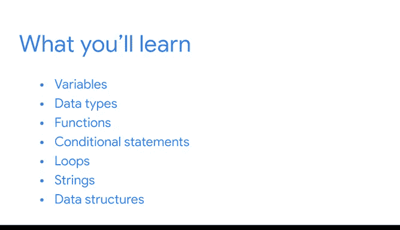

# 谷歌高阶数据分析 2：《Python入门》get-started-with-python（中英双字） - P1：01_01_01_课程介绍-2.zh_en - GPT中英字幕课程资源 - BV1Jm4y177BW

Hey there。 Welcome to the next stage of your learning journey。

 Congratulations on completing your first course。 You've learned how data professionals contribute to the success of an organization and the main tools and techniques they use on the job。

 Now you'll learn how to use one of the most powerful tools of available to data professionals。

 The Python programming language。 Comp programming refers to the process of giving instructions to a computer to perform an action or set of actions。

😊，You can use different programming languages to write these instructions。

You might choose a specific language based on the project you're working on or the problem you want to solve。

The Python programming language is super useful for working with data。

Data professionals use Python to analyze data in faster， more efficient and more powerful ways。

 because it optimizes every phase of the data workflow from exploring。

 cleaning and visualizing data to building machine learning models。😊。

This course will give you a strong foundation and Python fundamentals and prepare you for more advanced data work in your future career。

 If this is your first experience with the Python programming language。

 welcomee This course does not assume you have any prior knowledge of Python。😊。

We'll begin from the beginning and work through each concept step by step。

Take it one step at a time and go at your own pace。As you develop your Python skills。

 you apply what you learn to gain valuable practice working with data。

And if you have experience with Python， that's great， too。

 I'll help you apply your knowledge in a new way and demonstrate how to use Python for data analytics specifically。

Let me introduce myself。 My name's Adrian。 I work as a customer engineer at Google Cloud。

 This means that I work with our customers to understand the technologies they have at their disposal to solve data analytics needs。

 I first learned Python when I went to create an electronic journal。

 I got tired of buying a new physical one every year I learned how to password protectect it。

 and to this day it's still one of my proudest moments of using Python。

Throughout your career as a data professional， you'll have the opportunity to continually learn and grow。

 To me， that's one of the coolest aspects of the job。😊。

And learning Python is one of the most rewarding parts of that growth process。

 I'm still learning new ways to use Python all the time， both at work and for fun。😊，Now。

 let's review what you will learn。We'll start with a general introduction to Python and discuss why it's such a popular programming language among data professionals。

You'll learn fundamental coding concepts such as variables and data types and how they help store and organize your data。

You'll also get a chance to start writing your own Python code。Next。

 you'll explore functions or reusable chunks of code that let you perform specific tasks。

Functions help you work with data quickly and efficiently。

You'll also learn about conditional statements， which tell the computer how to make decisions based on your instructions。

Then you'll discover the power of loops， which repeat a portion of code until a process is complete。

You'll also learn how to work with strings， which are sequences of characters such as letters and punctuation marks。

After that， you'll explore data structures in Python。

 which are methods of storing and organizing data in a computer。

You'll review the most useful structures for data professionals such as lists， sets， dictionaries。

 and data frames。 Finally， you'll apply your Python skills and an end of course project that you can add to your professional portfolio。

😊。

The end， of course， project features a unique data set based on a workplace scenario。

In future job interviews， you can share your project as a demonstration of your skills and impress potential employers。

 Learning Python will take your data analysis skills to the next level。

 It'll also be a great addition to your resume。Knowing how to use Python is a key credential for data professionals and will give you a big boost as a job candidate。

I am here to help you every step of the way。 And remember， you set the pace。

 Feel free to watch the videos as many times as you like and review topics that are new to you。😊。

By the end of this course， you'll know how to use Python to explore and analyze data。

 Let's get started。

