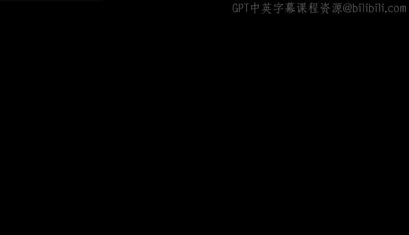
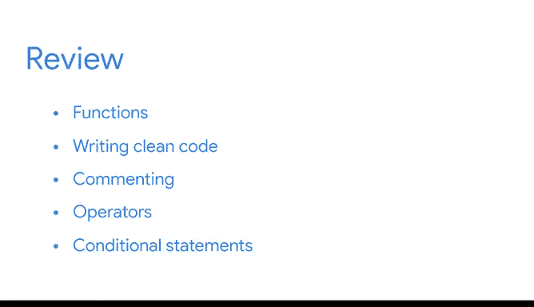

# 谷歌高阶数据分析 2：《Python入门》get-started-with-python（中英双字） - P20：20_02_01_总结_2.zh_en - GPT中英字幕课程资源 - BV1Jm4y177BW

You've come to the end of the second section of the Python course。

 You've added a lot of new Python skills to your skill set and gained valuable practice working with data。

 Well done。😊，Along the way， we've explored how Python code can help you quickly perform complex operations on your data you've also learned how to write clean。

 readable code that can be easily understood and reused by other data professionals。

This is an important part of collaborating with teammates on any data project。

Writing clean code will help your team reduce errors， work faster， communicate more effectively。

 and deliver better results。We begin by exploring functions or reusable chunks of code that let you perform specific tasks next we discussed two important elements of writing clean code。

 reusability and modularity。We also discussed another best practice for writing clean code。

 commenting。😊，After that， we've reviewed two types of Python operators。

 comparators and logical operators。 And finally， you learn how to write conditional statements such as if。

 Als and elset if statements Com up， you have a graded assessment。😊。

To prepare， review the reading that lists all the new terms you've learned and feel free to revisit videos。

 readings and other resources that cover key concepts。😊，Congratulations on your progress。

 Let's keep it going。😊。

