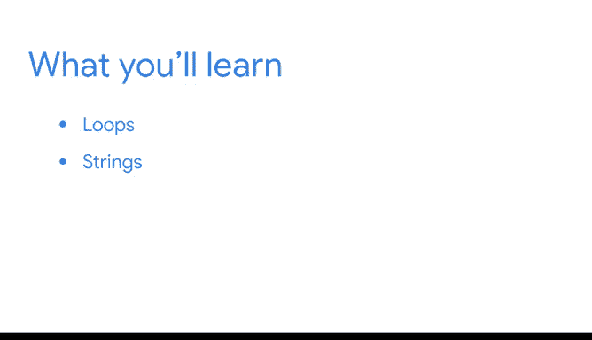

# 谷歌高阶数据分析 2：《Python入门》get-started-with-python（中英双字） - P21：21_03_01_欢迎来到模块3.zh_en - GPT中英字幕课程资源 - BV1Jm4y177BW

Welcome back。 Wow， you've learned a lot of new Python skills。

 You can use variables to store and label your data and convert and combine different data types。

 such as integers and floats。 You can call functions to perform useful actions on your data and use operators to compare values。

😊，You also know how to write clean code that can be easily understood and reused by other data professionals。

 Finally， you can write conditional statements to tell the computer how to make decisions based on your instructions。

Your knowledge of fundamental coding concepts is the first stage of a journey that leads to more advanced methods of data analysis。

And this learning journey will continue throughout your future career as a data professional。 To me。

 that's one of the most exciting parts of the job。 I'm always learning new ways use Python for data analysis。

 whether from teammates at work or from the super supportive online community。😊。

Learning new Python skills helps me become a more effective data professional In this section of the course。

 you'll learn how to use Python code to automate repetitive tasks。 Often。

 data professionals need programs to perform an action repeatedly。 For example。

 if you're analyzing sales data。 you may want to perform the same calculation on hundreds of price values。

 rather than write new code each time you want to make the calculation。

 You can instead write an iterative statement or loop。😊。

Loops automatically repeat a portion of code until a process is complete。

Well discuss two types of loops， while loops and four loops。

 using Python to automate repetitive tasks saves me tons of time and effort and reduces the risk of human error。

 It also reduces my overall work load， and increases my productivity。😊。

I have more free time to focus on the main goal of any data analysis project to generate insights for stakeholders。

 You can iterate over many different data types in Python， such as strings， lists。

 sets and dictionaries。 In this section of the course， Well focus on strings。 Later on。

 we'll discuss the other data types in detail。 as a data professional。

 you'll often work with strings when analyzing data。 For example。

 you might examine textual data related to a company's products， services。

 customer feedback and more。 operations like indexing and slicing， allow you to select。

 filter and edit data quickly and efficiently。😊。

These are valuable Python skills for any data professional。 When you're ready to learn more。

 I'll meet you in the next video。😊。