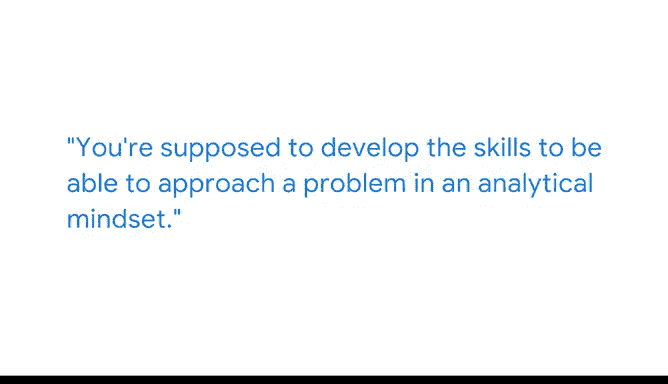

# 谷歌高阶数据分析 2：《Python入门》get-started-with-python（中英双字） - P22：22_03_02_米歇尔-以分析性思维解决问题.zh_en - GPT中英字幕课程资源 - BV1Jm4y177BW

My name is Michelle and I'm a data engineer here at Google I actually started as a documentation specialist right out of college。

 but being surrounded by so many technical people working within analytics really made me interested in the field and made me want to join the team and work in that world I anticipated that I would face judgment or。

You know， people looking down on the fact that I didn't have a degree in analytics when I was breaking into the field。

 and I am happy to report from my experience that did not happen。

 It was only my own negative self-talk in my head。 Everyone around me was welcoming and accepting and really happy to have someone who took a non-traditional path into engineering and analytics on the team because of the unique viewpoints that I brought。

 Ioster syndrome is a very real thing。 I think everybody experiences it。

 And so did I there were so many times where I would stop and think maybe I'm not meant to be here。

 I don't have an advanced degree in analytics or information science。😊。

Is there really anything that I could even contribute being in this room right here right now？

 And the way I got through it was realizing that。Having a career in data analytics and data science is not about memorizing every possible answer for every possible scenario。

 That's not it at all。 The purpose is you're supposed to develop the skills to be able to approach a problem in an analytical mindset。

 There was a project earlier in my career where I really wanted to automate part of an analytics workflow。

 And I knew what I needed to do， but I didn't know exactly how to do it。

The way I approached this problem was to first write down what I wanted to do in plain English without any computer code。

 any programming， nothing like that。 Then I had to do a lot of searching on Google。

 I was looking on various forums for how to do。X， Y， Z in Python， how to use a for loop。

 how to use Python for data science and automate analytics。

 And I slowly made my way over to completely automating the workflow that I wanted to automate one piece at is time Being able to automate that workflow has left me with a sense of accomplishment that has remained with me to this day。

 Sometimes it can seem really discouraging when you have a mountain of work in front of you or somewhere that you want to get to and you're thinking this is going to be impossible。

 but it's really not if you just break things down into smaller， more manageable chunks。

 you absolutely will get there。 and then you'll get to a point where you look back and think。

 oh my gosh， I did it。 I I've made it all the way here。

