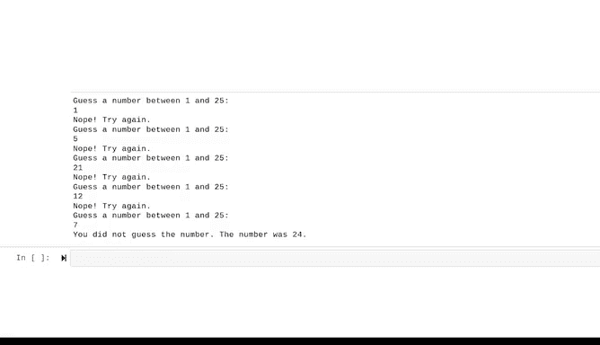

# 谷歌高阶数据分析 2：《Python入门》get-started-with-python（中英双字） - P23：23_03_03_while循环简介.zh_en - GPT中英字幕课程资源 - BV1Jm4y177BW

If you had to do the same thing over and over and over again， Well， you might get a bit loopy。

 And you'd probably think to yourself， I wish I could spend my time on something more meaningful。

 Well， that's where computers can help。 They do the looping for you。As a refresher。

 a loop is a block of code used to carry out iterations。

An iteration is the repeated execution of a set of statements where one iteration is the single execution of a block of code。

And an iterable is an object that's looped or iterated over。Typically。

 data professionals use four loops and while loops to work with iterables。

 in this video we'll focus on while loops。 A while loop is a loop that instructs your computer to continuously execute your code based on the value of a condition。

😊，Mgali and Fido are here to help me explain。Notice that Fido is eating treats while the treat bag is in Maggali's lap。

Fiddo stays until Maggali puts the treat bag away。Then Fido leaves。

This is a wild statement in action。 While Maggali has the treats， Fido is there。

 Once the condition of Maggali holding the treat bag is no longer met， Fido exits。After all。

 there are no more treats。While loops work in a similar way to branching， if statements。

 the difference is that。 And while loops， the body of the block can be executed multiple times instead of just once。

 This is great for avoiding redundancy in code。 Let's review an example。

 assign the value of 0 to the variable X。 As you've learned。

 we call this action initializing to give an initial value to a variable。Next， start the while loop。

Set a condition for this loop that x needs to be less than5。The prior line just initialized it。

 so this condition is currently true。Then end the while loopbl with a colon。On the next two lines。

 you may notice a block that's indented to the right。This is the Wild loop's body。

There are two lines in the body of the loop， and the first line print a message followed by the current value of x。

In the second line， increment the value of x by adding one to its current value and deciding it back to X。

In the body of the while loop， we told the computer to print the results of each iteration。

Notice how each iteration changed the value of x。Our while loop started at x equals 0。

 then printed the message。And increments the value of x to 1。But because this is a loop。

 the computer doesn't just continue executing with the next line in the script。 Instead。

 it loops back around to reevaluate the condition for the while loop。This is the second iteration。

And because one here is still less than five， it executes the body of the loop again。

The third iteration increments x by  one。 Now， the value of x is 2。

The computer will keep doing this until the condition isn't true anymore。

Let's add a print statement outside the body of the wall loop to let us know the final value of x。

When the loop finishes， the next line of code is executed。So now that x has reached the value 5。

 the loop statement ends。The computer prints the last line of output as x equals 5。

We can also use the logical operators and or and not that we worked with earlier。

Similar to if statements， using these operators allows us to combine the values of several expressions to get the result we want。

 The most important thing to remember is that the condition used by the wild loop needs to evaluate the true or false。

It doesn't matter if this is done by using comparison operators or calling additional functions。

 I think you're ready for an example that uses several different concepts that you've learned so far and even a couple that you haven't。

To help you explore the example， I'll guide you as we go， and I'll explain the concepts to you。

You'll probably find that as you continue on your journey learning Python。

 you'll encounter new concepts that can be understood in context。

It's the same way with spoken language。 If I say the elephant was so gargantuan that it crushed the car by stepping on it。

 The word gargantuan may or may not be in your vocabulary。

But the context helps us understand that it has something to do with being big or heavy。

 It's the same with coding。 Pa the video and try to figure out what this code is doing When you're ready。

 Con， and I'll lead you through it。😊，In this example。

 we're going to write a short program that generates a random number and then gives the user five chances to guess it。

We begin by importing a package called randomandom。This package has many uses。

 but the one we want is its ability to generate a random number。Now。

 instantiate a variable called number and use the random int function from the random package to assign it to value。

The value is a random number between 1 and 25 inclusive。Next。

 we instantiate another variable called number of guesses and assign it a value of 0。

 This variable is important because it will behave as a counter that controls the logic of our program。

Now comes our while loop。 We write while the number of guesses is less than 5。And below it。

 we give the instructions for what should happen at each iteration of the loop。First。

 the script will print a message telling the user to guess a number from 1 to 25。

Then we instantiate a new variable called Ga， which will capture a string of whatever the user inputs。

The input function used here will create a prompt that allows the user to type their guess。

The next line converts the guess to an integer。 This is important because without it。

 the input function would capture the number as a string， and it would be impossible to win the game。

 because even if they guessed the right number， the string of the number will never evaluate as being equal to the integer of the number。

Now， we increase the number of guesses variable by one。 This is an important step because remember。

 the while loop will continue to iterate for as long as the number of guesses variable is less than 5。

If we left this out， the loop would never stop running。

 and the user would have infinite guesses until they got it right。By the way。

 this syntax is a helpful shortcut。 Instead of writing number of guesses equals number of guesses plus 1。

 we can simply write number of guesses plus equals1。They mean the same thing， but one is way shorter。

Now we're going to have our branching logic that determines what the program does。

 we want the behavior to be different depending on how many guesses the user has made and whether their guess was correct or not。

This code is still within the body of the while loop， so it will execute on every iteration。

The first line checks if the guess is correct， if it is， the while loop breaks。

This word break is a key word that lets you escape a loop without triggering any else statement that follows it in the loop。

In this case， if the user guesses the correct number。

 the while loop would break and the code would continue at the if statement below。

 because the guess is correct， we print a message telling the user that they are correct and include how many tries it took them in the message。

But let's go back up to the while loop and go through what happens if the guess is not correct。

We use the Elli statement to check if the guess was their fifth guess。 If it was。

 we break the wall loop。Evaluation would continue below。 and because the guess was incorrect。

 it would trigger the very last out statement that outputs a message telling the user they were unsuccessful and revealing the correct number。

Without this LF statement， the code would still work kinda。The user will get a message saying，Nope。

 try again， and then immediately get another message telling them they were unsuccessful and revealing the number。

But if the guess was not their fifth guess， their code would proceed to the outstate。

 which prints Nope Tri again。Let's run the program and try to guess the number。

Congratulations， you just integrated a bunch of concepts into a single scriptive code and worked on a problem that incorporated some complex logic。

 These skills are invaluable to data professionals。😊。

