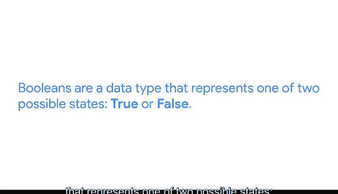

# 谷歌高阶数据分析 2：《Python入门》get-started-with-python（中英双字） - P25：25_03_02_多参数范围循环.zh_en - GPT中英字幕课程资源 - BV1Jm4y177BW

Earlier， you learned about the range function and how it generates a sequence of numbers。

 starting with 0。However， your work as a data professional won't always need to start with zero。

Instead， you might want to use a step parameter in the range function。

This makes it possible to specify which elements of a variable or data set we want to start and end with。

In this video， you'll learn how to use the three parameters of the range function。 Start value。

 stop value and step value。Here's a for loop that calculates a factorial of 9。

 Let's explore how it works。We begin by assigning a variable called product with the number one。Next。

 we have a range function that starts at one and stops at 10。

Since the stop value is not included in the calculation。

 this means that code multiplies a variable by every whole number in the sequence。

 beginning with one and ending with 9。So for n in range 1 to 10。

 we multiply our product variable by one and reassign the result back to itself。

Then we multiply the product variable by 2 and reassign the result back to itself， then by 3。

 all the way up to 9。This produces a factorial of 9。The factorial of 9 equals 362880。

Note that we started with one and not with zero。If we multiplied by0， the product would be 0。

The range function also lets us specify a third parameter to change the size of each step in our range。

In other words， instead of going one by one， you can have a larger difference between each of the values in your range。

 Let's explore an example。First， define a function that converts a temperature value from Fahrenheit to Celsius。

Use the standard conversion formula。The temperature in Fahrenheit that needs to be converted is identified by X。

32 is subtracted from x times 5， divided by 9。Next。

 we have a four loop that will print a table of temperature conversions every 10 degrees from 0 to 100 degrees Fahrenheit。

Notice that the four loops starts at 0 and goes up to 100 in steps of 10。

Remember that the range excludes the final value in the secrets。So to include 100 in our sequence。

 we put the n value as 101。The body of the for loop prints the value in Fahrenheit and the value in Celsius to create a conversion table。

For every 10 degrees Fahrenhe， the code prints the corresponding value in Celsius on each line。

So now you know more about setting parameters for the range function when you're working with for loops。

As a quick reminder， use four loops when there's a sequence of elements that you want to iterate over。

For example， to loop over a variable such as a record in a data set。

 it's always better to use for loops。This also improves readability of your code。

Use wild loops when you want to repeat an action until a Boolean condition changes without having to write the same code repeatedly。

 Remember， Boolean are a data type that represents one of two possible states， usually true or false。

And if whatever you're trying to do can be done with either a for loop or while loop。

 just use whatever you prefer。 I happen to love them both。

 and am really glad I have both tools in my Python tool box。😊。

