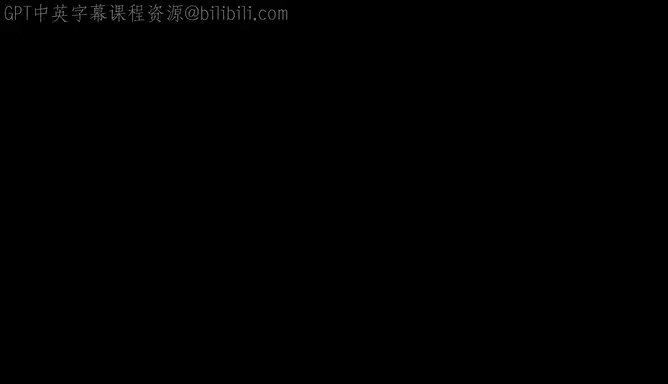
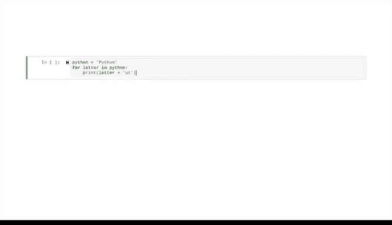

# 谷歌高阶数据分析 2：《Python入门》get-started-with-python（中英双字） - P26：26_03_01_字符串操作.zh_en - GPT中英字幕课程资源 - BV1Jm4y177BW

We have covered a lot of materials so far。 You learned about functions and conditional statements and loops。

 Now， we'll learn more about different data types in Python beginning with strings。

 recall that a string is a sequence of characters and punctuation that contains textual information。

😊，This is an immutable data type， which means the values can never be altered or updated。

 Even though strings are immutable， we can still do a lot with them。 For instance。

 we can concatenate them to concatenate means to link or join together。

 So concatenating strings is making a single， longer string from two or more shorter ones to concatenate strings in Python。

 we simply use the addition operator。 If we have two strings。 Hello and world。

 we can join them by adding them together。😊，The result is a single string。

 but it's also a single word。This is because blank spaces or white spaces。

 as they're known in computer programming， count as their own characters。

If you want a white space between your concatenated strings。

 one of the strings must contain a white space。Or you must add a third string between them that contains just a white space。

The same rules apply when using variables that point2 strings。

If Ho is assigned to greeting 1 and world is assigned to greeting 2。

 we can concatenate the strings by adding the two variables。

We can also multiply strings using the multiplication operator。Daer times 3 equals danger， danger。

 danger。However， we cannot divide or subtract strings and trying to do so will throw an error。

As you know， some characters are reserved for specific purposes when working with strings。

For example， quotation marks are used to indicate the beginning and end of strings。

But what if we want our string to contain quotation marks。There are two ways we can approach this。

The first way takes advantage of the fact that strings can be written with either single quotes or double quotes。

If you want to include double quotation marks in your string。

 use single quotation marks to begin and end your string and vice versa。

The second way is to use the back slash， which functions as an escape character。

 an escape character changes the typical behavior of the characters that follow it。 In this case。

 the typical behavior of quotation marks is to begin or end the string。

 But if we proceed each with the back slash。 though'll behave as regular punctuation marks in the string。

The back slash character is useful as an escape character for other special characters and strings。

 too， For example， back slash N is a special character combination that's used to indicate a new line when printing a string。

😊，But if you want to include back slash n as characters in your string when you print it。

 you must precede the combination with an initial backslash。Moving on。

 we can also iterate over strings with loops。 In this example。

 we use a for loop to iterate over each letter of the word Python and print the letter plus the letters U T。

😊。

These are just a few of the ways to work with strings。 As a data professional。

 you'll often work with strings when analyzing data Com up。

 will' cover more useful operations that we can perform over strings。

