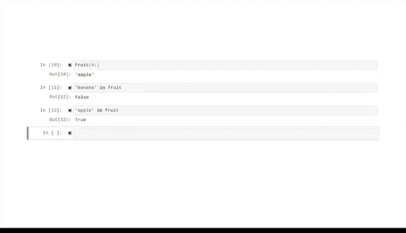

# 谷歌高阶数据分析 2：《Python入门》get-started-with-python（中英双字） - P27：27_03_02_字符串切片.zh_en - GPT中英字幕课程资源 - BV1Jm4y177BW

Recently， you learned the basics of strings In this video。

 you'll add to your knowledge by exploring a new way to work with strings， slicing。

 But before you learn about slicing， you'll need some background information about how Python works as a reminder。

 an object is iterable if you can sequence through all of its values or items。😊。

Indexing is Python's way of letting us refer to individual items within an iterable by the relative position。

Indexing is a very important part of Python， because it allows us to select， filter。

 edit and manipulate data， and it opens up many possibilities to the data professional。 By the way。

 indexing isn't just for strings。 It also works on many other data types， like lists， tus and others。

 as long as they're iterable。😊，You'll learn about these other data types soon。

 Python uses0 based indexing。 That means that the first element of a sequence is indexed as 0 with strings。

 indexing works by interpreting a string as a sequence of characters where each character has a numbered slot。

 If you're reading from left to right。 The first character is located at slot 0。

The second character is located at slot 1 and the third at slot 2， and so on。

Indexing lets us slice strings to create smaller strings or sub strings。

 Here's an example that many data professionals have experience with。😊。

A column in a data set contains employee salary information。In the same field。

 there will be both strings and integers。 The currency symbol and the salary amount。In this case。

 Python would automatically interpret the mix of data types as a string data type。

 This is often a problem because we usually want values that represent money to behave like numbers so we can perform mathematical operations on them。

If they're strings， we can't do that。 So to fix the problem。

 slicing helps us remove the nonnumeric characters like the dollar sign from the string。

 In this case， we could drop the character at the0 index of each value in the salary column。

 This gives us salary information without the currency prefix。😊。

Let's explore some ways of working with indices。One useful tool is the index method。

Index is a string method that outputs the index number of a character in a string。 Remember。

 a method is a function that applies to a variable。

 We can call it by following the variable with a dot。

 We use the index method to identify the location of a character or sub string in a string。

Here we have a variable called pets， which has been assigned to string cats and dogs。

We use the index method by attaching it to the PEs variable with a dot。In its parentheses。

 we enter the character we want the index of。Let's find S。When we run the cell。

 the computer returns the number 3。This means that index 3 of our string contains the letter S。

 What if there is more than one of the same character or sub string。Here。

 we know that there are two ss in cats and dogs， but only one index returns to us 3。

That's because the index method just returns the first position that matches。

And if you search for a substring that is not there， say Z。

 you'll get a value error because a substring is not found。Additionally。

 we can also use an index number to find a specific character in that position。For example。

 we'll assign this string Jolene to a variable called name。

By placing the index number in brackets after the variable。

 we can access the character at that position。Name at index 0 is J。And name at index 5 is E。

What happens if we put 6 instead， We'd get an index error indicating that the string index is out of range。

You can access the last character of a string， even when you don't know how long the string is by using negative indices。

 Let's consider an example。We don't know the length of this string。

 but it doesn't matter since it isn't super efficient to count each character out。

 we can reference it by starting from the last position with a negative index。

By using the index negative one， we get the last character， an exclamation point。

And if we use the index negative，2， we get the second to last character a。

Now that we've gone over the fundamentals of indexing， let's do some slicing。

 A string slice is a portion of a string。 It's also known as a sub string。

 String slices can contain more than one character。

 Here's an example of how we slice a string of the word orange。😊。

Let's start by putting some index numbers inside square brackets and separating the numbers by a colon。

This defines the range of characters in the new slice。We'll go from index1 up to index 4。

The closing index is not included in the range that's returned to us。

 So this would capture indices 1，2， and 3。And we've extracted a slice that contains the characters that correspond to these indices。

 R， A， N。😊，We can also use slice notation with just one of the two indices。

Omitting the first number in the range implies that the range begins at 0。

So if the string is pineapple and we indicate our slice using coal4 willll capture the first four letters。

 pine。😊，Similarly， if we slice using4 colon， we'll capture everything beginning with index 4 all the way to the end。

 Apple。Great， we have one more thing to learn。 Sometimes data professionals want to check whether or not a sub string is contained in a string to check whether or not a sub string is contained in a string。

 Use the key word in。 Let's find out if banana is in the string contained and our fruit variable。😊。

It's false。 There is no banana in our pineapple。But is there Apple， Let's check。Yes。

 Apple is a substring of pineapple， so the computer returns a value of true。

Confirming whether a substr is contained in a string is a common practice in all kinds of data careers。

 I encourage you to take some time to go through the steps again on your own。

 The more you apply what you learn， the more comfortable you will become。😊。

