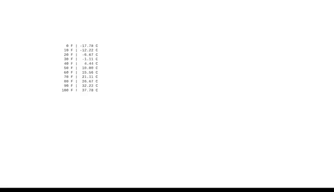

# 谷歌高阶数据分析 2：《Python入门》get-started-with-python（中英双字） - P28：28_03_04_格式化字符串.zh_en - GPT中英字幕课程资源 - BV1Jm4y177BW

As you're discovering， understanding strings is a big part of Python and programming success。😊。

Now that you have a foundational understanding of strings。

 let's learn some new approaches to save time when creating and manipulating strings。 In this video。

 we'll focus on formatting strings using the format method。

 The format method formats and inserts specific substrs into designated places within a larger string。

 Let's examine how this appears in code。😊，We have two variables， name and number。

The format method uses the curly braces to designate where the variables should be inserted into the string。

If we pass the variable names as parameters to the format method。

 we find that it doesn't matter that the name is a string， and the number is an integer。

The format method will insert strings of the values represented by these variables。

The order that they're inserted in is the order that they're entered as parameters into the format method。

In this case， name corresponds to the first set of braces and number correspond to the second set。

You can also be more explicit with how you designate what sub string goes where you can name your own key words and insert them into the braces。

 In this case， we'll use name and none。Now we explicitly assign our variables to those key words in the method parameters。

When we run the cell， the values represented by the variables get inserted into the printed string。

 according to their keywords。 Notice that when we do it this way。

 the order that we enter the method arguments doesn't matter。

 Name will be inserted into the name field in the string and number will be inserted into the numb field of the string。

 This approach is very helpful。 For example， in cases where an output message needs to be translated into another language。

Many languages change the order of words to communicate the same message。

 This method makes rearranging strings fast and easy。 And yet。

 another way to insert values into strings is to use integer values in the braces to indicate the order in which to insert the arguments。

 Notice how this example， we can enter the variables number and name in the argument field in a different order than they get inserted into the printed string。

As a data professional， these different ways to insert values into strings offer you a lot of flexibility and how you choose to work and solve problems。

 Here is an example that not only insert sub strings into a larger string， but also formats them。

 Imagine you want to print the price of an item with and without tax。Depending on the tax rate。

 the number might extend more than two places beyond the decimal。

 We can use string formatting to set a limit on the number of decimal places in the output。

 which makes it more readable。In this case， our item costs $7。75 cents without tax。

 and the tax rate is 7 per cent。 So the price with tax would be $8，2，9，2，5。

 to limit the output to two places beyond the decimal point， we use special syntax。

 Start with a colon to separate the expression from the keyword name。 If you decide to use one。

After the colon， write dot2 F。Dot2 refers to two places beyond the decimal， and F stands for floatat。

Now， let's check what happens when we run this cell。 Nice， the price with tax has two decimals now。

You can replace the two in the expression to any number of places beyond the decimal you want。

If you put 0， only a whole number will print。We're not done yet。

There are even more ways to use the format function to improve expressions。

 Let's explore our conversion of temperature values from Fahrenheit to Celsius from earlier at the top is the function we wrote to calculate the conversion。

😊，But now， instead of just printing the results， we'll format them， too。 again， begin with a colon。

 then use the greater than operator to align the text to the right so that the output is neatly formatted。

Greater than three will align the output3 spaces to the right。

For the converted Celsius value will use greater than 6。

 which will align the Celsius temperatures 6 spaces to the right。 Notice how clean the output is。

 Our decimals are cut at the hundreds place， and the values output in a nice table。😊。

Everything you've been learning about strings will help you work more effectively。

 streamline processes and save your company lots of time and resources。😊。

Using Python is all about maximizing productivity while minimizing effort。

 making it the perfect tool to help you achieve these goals。

