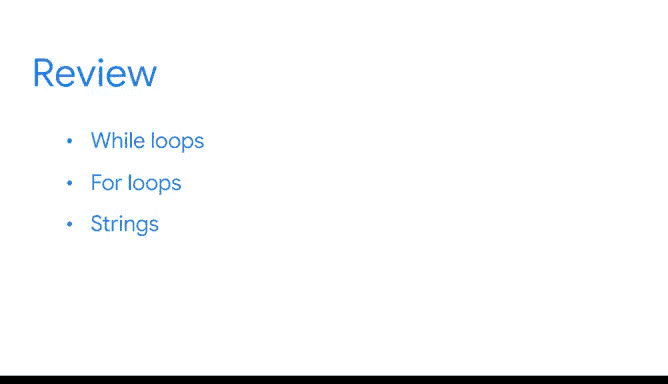

# 谷歌高阶数据分析 2：《Python入门》get-started-with-python（中英双字） - P29：29_03_01_总结_3.zh_en - GPT中英字幕课程资源 - BV1Jm4y177BW

This is the end of the third section of the Python course。

 You've come a long way since the beginning of the course。 Congratulations on all your progress。

 In this section of the course， we focused on using Python code to automate repetitive tasks rather than write new code each time you want the computer to repeat an action。

 You can instead write an iterative statement or loop。

 loops auto repeat a portion of the code until a process is complete。

 using Python to automate repetitive tasks will help you work more effectively。

 streamline processes and save tons of time and effort。😊，As a data professional。

 you'll have more time available for your most important task。

Analyzing data to generate useful insights for stakeholders。

We discussed two different approaches to automating repetitive tasks， while loops and four loops。

You learn how to write code for both while and four loops and when to use each approach。

We also discuss strings or sequences of characters like letters and punctuation marks。

 You learn how to manipulate strings by slicing， indexing and formatting them as a data professional。

 you'll often work with textual data such as product information or customer feedback。

 operations like slicing and indexing enable you to select。

 filter and edit data quickly and efficiently。 Learning Python is an exciting journey that will continue throughout your future career。

😊。

Each data project that I work on has its own specific challenges。

 I'm always exploring online or chatting with teammates to learn new Python skills on the job。

 This helps me solve problems and work more efficiently As you continue learning and practicing Python。

 your data analyticsly skill set will continue to grow Com up。

 you have a graded assessment to prepare。 review the reading that lists all the new terms you've learned and feel free to revisit videos。

 readings and other resources that cover key concepts You're doing great。 Keep it up。😊。

