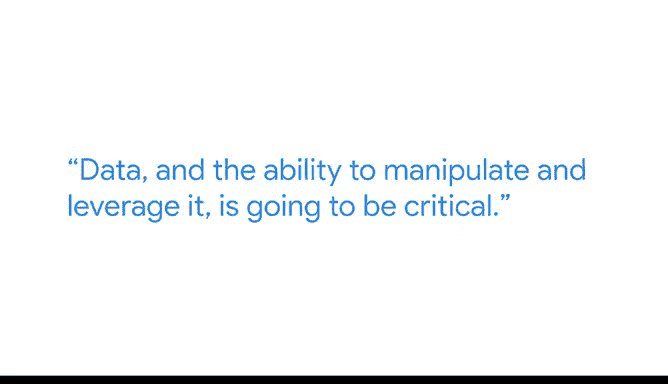

# 谷歌高阶数据分析 2：《Python入门》get-started-with-python（中英双字） - P2：02_01_03_阿德里安-我的数据职业发展之路.zh_en - GPT中英字幕课程资源 - BV1Jm4y177BW

My name's Adrian， I work as a customer engineer at Google Cloud。

 this means that I work with our customers to understand the technologies they have at their disposal to solve data analytics needs。

😡，I come from a nontraditional background， started out in nursing。

 I spent several years there before I realized that while dealing with patients and helping patients was definitely fulfilling。

 It wasn't exactly what I wanted to do with the rest of my life。

 There were a number of transferable skills that I learned from my previous career as a nurse。

 first being critical thinking， Second problem solving and third assessment within advanced data analytics。

 critical thinking and problem solving becomes key when trying to debug。 Furthermore。

 when looking for answers online， you need to be able to assess what information you're being given and understand how to apply to fix your problem。

 Another skill that I was able to bring over from nursing is soft skills are interperal skills。

 which are critical and advanced aid analytics as you try to work with others and a collaborative space。

😊，I got into this career because I had gained skills related to programming just throughout my life。

 I didn't really understand how I could apply it or the fact that I could actually apply it when I got an undergraduate degree in English and history and it was after realizing what the job opportunities were for humanities that I had to think again about what my next step would be that's where technology came into play and I found that I could actually use technology and integrate that with what I was doing from a humanities point of view with English and history and get into digital humanities。

That led me to data analytics through the process of or the concept of knowledge management。

 we're in a space where every company is going to become a data company。

 whether you're working in medicine， whether you're working in retail， whatever it might be。

 data and the ability to manipulate and leverage it is going to be critical。

My favorite thing about data analytics is it can be incredibly entry level。

 Once you understand those basics， you can get started on your own。

 You don't need to have a formalized university degree。

 You don't need to have years and years of experience。

 Getting started is something that can be done as long as you put in the work to get the elementary foundation down。

