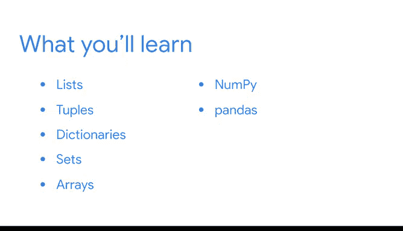

# 谷歌高阶数据分析 2：《Python入门》get-started-with-python（中英双字） - P30：30_04_01_欢迎来到模块4.zh_en - GPT中英字幕课程资源 - BV1Jm4y177BW

Hello again。 You've come so far on your learning journey。

 Just think of all the new Python skill you've developed along the way。

 You've learned how to use variables to store and label your data and how to work with different data types such as integers。

 floats and strings。 You can call functions to perform actions on your data。

 and use operators to compare values。 You also know how to write clean code that can be easily understood and reused by other data professionals。

😊，You can write conditional statements to tell the computer how to make decisions based on your instructions。

 and recently you learn how to use loops to automate repetitive tasks。Coming up。

 we'll explore data structures， which are collections of data values or objects that contain different data types。

Data professionals use data structures to store， access。

 organize and categorize their data with speed and efficiency。

 knowing which data structures fit your specific task is a key part of data work and will help streamline your analysis。

Will focus on data structures that are among the most useful for data professionals， Ls， tus。

 dictionaries， sets and arrays。 part of what makes Python such a powerful and versatile programming language。

 are the libraries and packages that are available to it。

 After we review fundamental data structures will' discuss two of the most important libraries and packages for data professionals。

 The first is numerical Python or Ny， which is known for its high performance computational power。

 data professionals use Nmpy to rapidly process large quantities of data。 I often use Nmpy in my job。

 because it's so useful for analyzing large and complex data sets。

 The second is Python data analysis library or pandas。

 which is a key tool for advanced data analytics。 Padas makes analyzing data in the form of a table with rows and columns easier and more efficient。

 because it has tools specifically designed for the job。😊。

When you're ready， I'll meet you in the next video。

