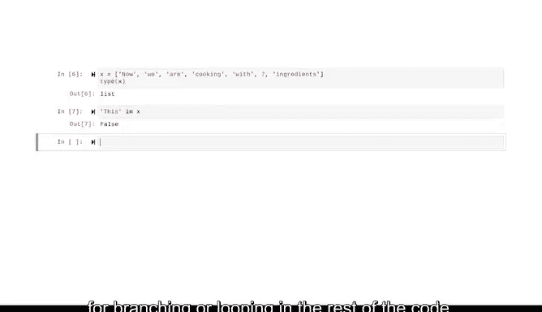

# 谷歌高阶数据分析 2：《Python入门》get-started-with-python（中英双字） - P31：31_04_02_列表简介.zh_en - GPT中英字幕课程资源 - BV1Jm4y177BW

Great to be with you again。 In this video， we'll discuss the differences between data types and data structures。

 Then we'll explore lists， which are a specific kind of data structure。😊，As you've learned。

 a data type is an attribute that describes a piece of data based on its values。

 its programming language or the operations it can perform。In the context of Python。

 this includes the classes， integers， strings， floats， and Booleing expressions， among others。

A data structure is a collection of data values or objects that can contain different data types。

 so data structures can contain data type elements， such as a float or a string。

 Data structures also enable more efficient storage， access and modifications。

 They allow you to organize and categorize your data relate collections of data to each other and perform operations accordingly。

 One data structure in Python as a list。 A list is a data structure that helps store。

 and if necessary， manipulate an ordered collection of items。

 such as a list of email addresses associated with the user account。 A list is a lot like a string。

 and you can do many of the same things with lists。 For example。

 both strings and lists allow duplicate elements， as well as indexing and slicing。 Additionally。

 both our sequences。 A sequence is a positionally ordered collection of items。 However。

 strings are sequences of characters。 while lists store sequences of elements of any data。😊。

There are some other key differences between lists and strings。 First。

 note that different data structures are either mutable or immutable。

 Muutability refers to the ability to change the internal state of a data structure。

 Imutability is the reverse where a data structure or elements values can never be altered or updated。

Listists and their contents are mutable， so their elements can be modified， added or removed。😡，But。

 strings are immutable。Think of a list like a long box with the space inside divided into different slots。

 Each slot contains a value， and each value can store data。This could be another data structure。

 such as another list or an integer， string， float， or output from another function。

When working with lists， you use an index to access each of the elements。😡。

Recall that an index provides the numbered position of each element in an ordered sequence。

In this case， our sequence is a list。Let's go through an indexing example together。First。

 assign the following list of words to a variable X。 Now we are cooking with seven ingredients。

In Python， we use square brackets to indicate where the list starts and ends and commas to separate each element contained in it。

To print an element of a list， use its index number。 So to print the word cooking。

 print the third element of the list variable X。This is just like focusing on a specific character or substrring in a string。

The first element in a list， as with strings is0。So if we print the element with slot number three。

 we get the item or word cooking from our list of seven words。

Remember that indexing always starts at 0。 So if we had type 7 to try to access the last word of our list。

We'd get an index error。We can also use indices to create a slice of the list。For this。

 use ranges of two numbers separated by a colon。To get the second and third words of our list。

 we and are， you can also use a colon2 to get all words until the index slap 2。 we get now and we。

 which have index laps 0 and 1。 And to leave one of the range indexes empty， use 2 colon。

 This will give us the other part of the list。 So just as with string indexing。

 the first value for the first element in the list， defaults to 0。😊，And the second value。

 if left empty， defaults to the length of the list。

To check if a list of words contains a certain element， like the word this。

Use the key word in to generate a boolean statement。 This verifies whether the word exists。

The result of this check is a boolean， which we can then use as a condition for branching or looping in the rest of the code。

 Ls are very useful when you're working with many related values。

 They enable you to keep the right data together， simplify your code and perform the same operations on multiple values at once。

😊。

Coming up， we have even more on lists。