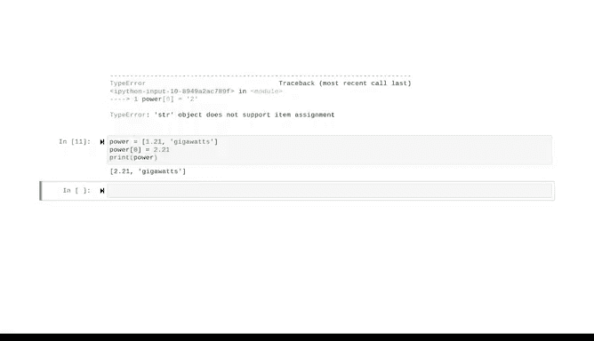

# 谷歌高阶数据分析 2：《Python入门》get-started-with-python（中英双字） - P32：32_04_03_修改列表内容.zh_en - GPT中英字幕课程资源 - BV1Jm4y177BW

In this video， we'll continue with lists。 You'll learn how to modify the contents of a list。

 This will give you greater control over your lists， because you can add。

 remove and change the items that they contain。😊，Previously。

 we thought about a list as a box divided into different slots。 Moing it means we can keep the box。

 but we add， remove or change what's inside。When thinking about modifying lists。

 there are a few methods that can be used。We'll begin with the append method。

 The append method adds an element to the end of a list。 This requires one argument。

 because this function adds the incoming element to the end of the list as a single new entry。

 You can even start with an empty list， and all new elements will be added at the end。

 Let's explore an example。 We'll begin by typing a list of fruits。 Upon further inspection。

 It seems we forgot to add kiwi to the list。So we can use the append method to add it。

This uses one parameter， in this case， the string Qwi。

Another common method for modifying lists is insert， which requires two arguments。

 The index number of the element to be modified and the contents being put in that slot。

 such as a string or integer。 Let's investigate how insert works。

Insert is a function that takes an index as the first parameter and an element as the second parameter。

 Then inserts the element into a list at the given index。Returning to our list of fruits。Now。

 orange is inserted at the second spot at index1 in our fruit list。

Let's add an element at the beginning of the list。In the first parameter， we'll put 0。

Then type mango as a second element。To remove an element from a list。

 let's consider the remove method。 Removeve is a method that removes an element from a list。

Similar to the append method， remove only requires one parameter。Now。

 our fruit list no longer has a banana。If we try to remove an element that is not in the list like strawberries。

 for example， we get a value error。Another common way to remove elements is with the pop method。

 which uses an index。 P extracts an element from a list by removing it at a given index。

So to remove orange， pop the third element in the list with index number two。Now。

 suppose that after removing orange， you decide to also remove pineapple and replace it with mango。

 Simply reassign its value。 Refence the pineapples items， index number 1， and replace it with mango。

 This renders the list without orange， because we already removed it， as well as mango。

 which replaced pineapple。Our fruits have changed a lot since we started。

 but it's always the same list， the same box。 We've just modified what's inside。At this point。

 I want to address something that new learners of Python often wonder about。

 You will recall that strings are immutable unless lists aremable。

 What this means exactly might not be clear at first。 After all。

 didn't we have multiple videos about how to manipulate strings。

 A new example will help make this more clear。Whenever we modify a string。

 we always have to reassign the change back to the variable that contained the string。

This is overriding the existing variable with a brand new one。

Notice that we can't say overwrite the character at index 0。 we get an error。😡，However。

 we can do this with a list。That's why lists are considered mutable。

Great work modifying lists。 Now， after all that talk about tasty fruit。

 I think we deserve a snack break。 I'll catch up with you again， very soon。😊。

