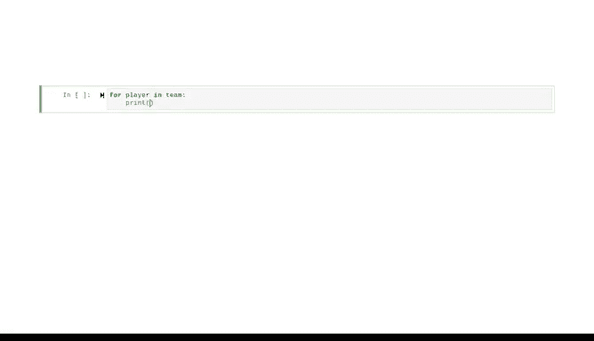

# 谷歌高阶数据分析 2：《Python入门》get-started-with-python（中英双字） - P33：33_04_05_元组简介.zh_en - GPT中英字幕课程资源 - BV1Jm4y177BW

As a data professional， sometimes it will be more important to access and reference data than to change and manipulate it。

When you simply need to find some information， but keep the data intact。

 you can use a data structure called a Tple。 A Tple is an immutable sequence that can contain elements of any data type。

Tups are kind of like lists， but they're more secure because they cannot be changed as easily。

They're helpful because they keep data that needs to be processed together in the same structure。

Tups are instantiated or expressed with parentheses or the tuple function。

Here we have a tuple that represents someone's full name。

Notice that it was instantiated using parentheses。 The first element of the tuple is their first name。

 The second is the first letter of their middle name， and the third is their last name。

 The position of the element is fixed in tus。 So you can't add new elements in the middle。

 and you can't change any of the elements。 If we try to change the last name。

 which lives in index number 2， from Hopper to copper。 The code will throw an error。

You can add a value to the end， but only if you reassign the tuple。

Another way we can create tus is by using the Tple function to transform input into tus。In this case。

 our name is represented as a list， we can convert the list to a tuple by using the Tupple function。

Notice that the name is no longer a list， so it doesn't have the brackets anymore。

 Tupples are also used to return values and functions。 In fact。

 when a function returns more than one value， it's actually returning a tuple。For example。

 here is a function that takes as an argument， a float value that represents a price。

 The function returns the number of dollars and cents。

 Notice that when we use the function to convert $6。55 to dollars and cents。

 the return value is represented as a tuple that contains two numbers。Interestingly。

 even though tus are immutable， they can be split into separate variables。

When we run the $2 sets function， we can directly assign the output into distinct variables。

 The information stored as a tuple in the result variable has now been reassigned to two separate variables that we can manipulate as we please。

 This process is known as unpacking a tuple。 Notice that the unpacked variables themselves are no longer tus。

 In this case， their integers。A big advantage of working with Ts is that they let you store data of different types inside other data structures。

 Here's an example of how this might be useful。This is a list of the starting five players on a university women's basketball team。

 Each player is represented by a tuple that contains their name， age and position。

This is a useful way of working with this type of information。

 The order of the players doesn't matter that much， And we might want to add to or rearrange them。

 So we use a list which is mutable。 However， the players themselves are individual records that are represented by tuples。

 They are a bit more secure because tuples are immutable and more difficult to accidentally change。

Because lists and tuples are iterable， we can extract information from them using loops。 For example。

 we can write a four loop that unpacks each tuple into three separate variables and then prints one of the variables for each iteration。

This is equivalent to looping over each player record and printing the record at index0。

Using tus and data professional work helps make your processes more efficient。

 It saves memory and can really optimize your programs， too， Plus。

 when others collaborate with you on your code， your use of tus will make it clear to them that your sequences of values are not intended to be modified。

😊，This is yet another great way to save your team time and effort。

