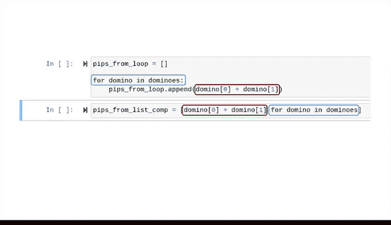

# 谷歌高阶数据分析 2：《Python入门》get-started-with-python（中英双字） - P34：34_04_07_循环、列表与元组进阶.zh_en - GPT中英字幕课程资源 - BV1Jm4y177BW

Hello again。 In this video， we'll consider more complex examples of different ways to work with loops。

 Ls and tuples。 I'll also introduce a few new tools that are useful for data professionals。😊。

Let's return to the women's basketball team list of players from the previous video。 In this example。

 we'll integrate string formatting， loops， tuples and lists。😊，Remember。

 we have a list of tuples where each tuple contains the name， age and position of a player。

Let's define a function that extracts the name and position of each player into a list that well use to print the information。

Well call the function player position， and its argument will be a list of tus that contain player information。

Next， we'll instantiate an empty list that will hold our result。

 which will build as we loop through the data。Now we'll use a four loop to unpack the tus and our list of players。

The variables we assign in the for loop must align with the format of the tuples。

There are three components of each tuple and our list， name， age and position。

So we need three variables in our for loop。If we tried to unpack the tus using only two variables like for name。

 age， and players， the computer would throw an error。

It wouldn't know what to do because there are three elements of the tuple。

 but we're only giving the computer two containers to put them in。So we'll begin our for loop。

 for name， age， position and players。Then well use string formatting to append each name and position to the result list。

Each string will include some positional formatting and a new line too。Finally。

 we'll call this function in a for loop。This for loop will iterate over the results list that is output by the function and print each one。

Now we have a nicely formatted， easily readable table of players and positions。

Here's another application of loops and lists。This is an example of nested loops。

 A nested loop is when you have one loop inside another loop。

 These loops create all the different domino tiles and a set of dominoes。

 which is a tile base game played with numbered gaming pieces。

 Feel free to pause a video and try to figure out what's happening。😊。

We start with the numbers on the left side of the dominoes。

 These numbers represent the dots or pips on the domino。They range from  zero to 6。

For each number in this range well run another loop to generate the pips on the right side of the domino。

 Then we insert the left number and right number into a formatted print statement。

And here are the dominoes。 notice that in this first print statement。

 we've included a parameter called end， whose value was a white space。

When a print statement executes by default， it will end with a new line。So without this parameter。

 all the dominoes would have been printed in a vertical line， each one beneath the next。

But when we set the end character to a white space， it prints a space between each domino instead。

Here's the same code， but instead of printing the dominoes as strings。

 it stores each one as a tuple of integers in a list called dominoes。Now。

 suppose we want to check the second number of the tuple at index 4。

 We can do that by using indexing。 Start with the list we want to access dominoes and put the index of the tuple we want to access in brackets。

 Then add another pair of brackets containing the index of the value within that tuple。

What if we want to calculate the total number of ps on each domino。

We can do that with the for loop that iterates over each tuple sums the value at index 0 and the value at index1。

 and appends the sum to a list。But there's a much easier way of doing this。

 It's called a list comprehension。A list comprehension formula millaically creates a new list based on the values in an existing list。

Here's how it works。Begin by assigning a variable for a new list。

 We'll call this one Pipps from list comp。For its value， create an empty list。 Now。

 we basically write a for loop only in reverse。 We begin with the calculation that creates each element of the list。

In this case， we want each element to be the total number of pips on the domino。

Which is the domino at index 0 plus the domino index 1。Then we add a four statement。

We can check to make sure it gave the same result as our for loop。They're the same。

Note what happened。 This is why I said a list comprehension is like a for loop written in reverse。

The four part of it is at the end of the statement， and the computation is at the beginning。

Both the for loopbe and the list comprehension do the same thing。

 but the list comprehension is much more elegant and usually faster to execute， too。

Hopefully， by now， you can appreciate how powerful the building blocks of Python can be。

 I encourage you to explore this notebook on your own and play with the code to discover what happens when you add something here or change something there。

 playing with code is one of the best ways to learn。 I'll see you soon。😊。

