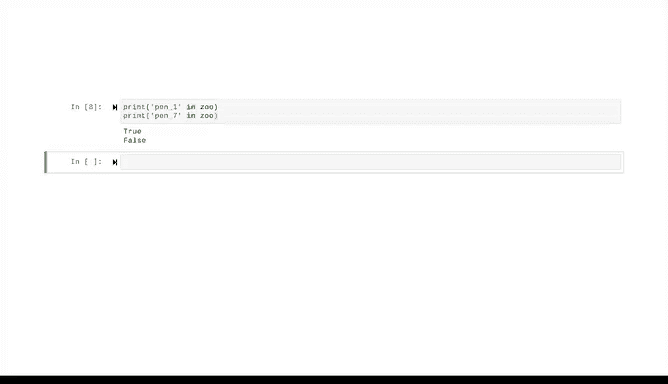

# 谷歌高阶数据分析 2：《Python入门》get-started-with-python（中英双字） - P35：35_04_01_字典简介.zh_en - GPT中英字幕课程资源 - BV1Jm4y177BW

Dictionaries are one of the most widely used and important data structures in Python。

A dictionary is a data structure that consists of a collection of key value pairs。

 They are instantiated with braces， or the diic function。We'll discuss that more shortly。

 Both veteran and entry level data professionals use dictionaries to analyze large data sets with fast processing power。

This helps them gather and transform user information。

 Dictionaries also provide a straightforward way to store data。

 making it easier for users to find specific information to use a regular dictionary。

 not the data structure， but the actual book with words and definitions。 You look up the word。

 Find it。 Then read its definition。 It's essentially the same with the Python dictionary。

 You look up the key， which will let you access the values associated with that key。

That's what's meant by key value pairs。Here's a simple example to illustrate the concept。

Suppose we have a zoo， and the zoo has different pens that contain different animals。

We could have a dictionary that stores this information for us with the pen numbers as keys and the animals as values。

We could use this dictionary to look up which animals are in each pen。For example。

 if we want to know what animals are in pen 2， we type the name of the dictionary， zoo。

 followed by the pen in brackets。Accessing a dictionary this way always searches over the keys and returns the values of the corresponding key。

 It doesn't work the other way around。 I can't use indexing to search for zebras and find out their pen。

 I will get a key error。 because zebras is not a key in the dictionary。

Dictionaries are instantiated mainly in two ways。 The first way is with braces。With this approach。

 each key is separated from its value by a colon， and each key value pair is separated from the next by a comma。

 The second way to create a dictionary is with the diiced function。When using the diict function。

 the syntax is a little different。When the keys are strings， you can type them as keyword arguments。

The last time we made this dictionary， we used quotation marks to indicate that the keys were strings。

Here， we don't， because they're keyword arguments。Also。

 instead of using a colon between the keys and their values， you use an equal sign。

The dictionary lookup is the same， irrespective of whether braces or the diict function is used。

The dit function is also a little more flexible in how it can be used。For example。

 we can create this same dictionary once again by passing a list of lists as an argument or even a list of tus。

 a tuple of tus or a tuple of lists。They all give us the same result。

If we want to add a new key value pair to an existing dictionary， say to put crocodiles in pen 4。

 we can assign it like this。A dictionary's keys must be immutable。 Imutable keys include。

 but are not limited to integers， floats， tuples and strings。Lists。

 sets and other dictionaries are not included in this category， since they are mutable。

Another important thing to note about dictionaries is that they're unordered。

That means you can't access them by referencing a positional index。

 If I try to access our zoo dictionary at index 2， I get a key error because the computer is interpreting。

 the two as a dictionary key， not as an index， Also， because dictionaries are unordered。

 you'll sometimes find that the order of the entries can change as your working with them。

 If the order of your data is important， it's better to use an order data structure like a list。

Finally， you can check if a keyword exists in your dictionary simply by using the in keyword。

Note that this only works for keys。 You can't check for values this way。

 There's a lot that we can do with dictionaries。 And what we've reviewed here is only the beginning。

Next， we'll consider more examples that show the power of dictionaries。

You'll also learn about some tools that make working dictionaries easy and convenient。Meet you there。

