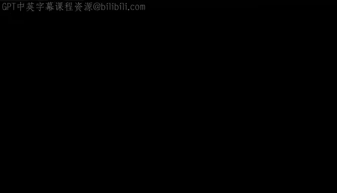
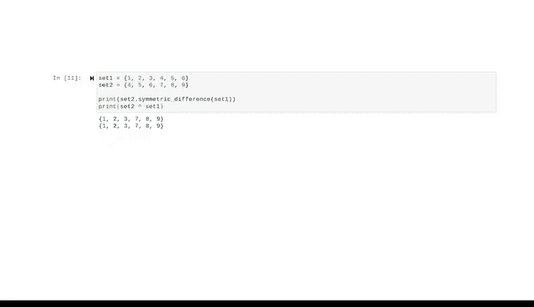
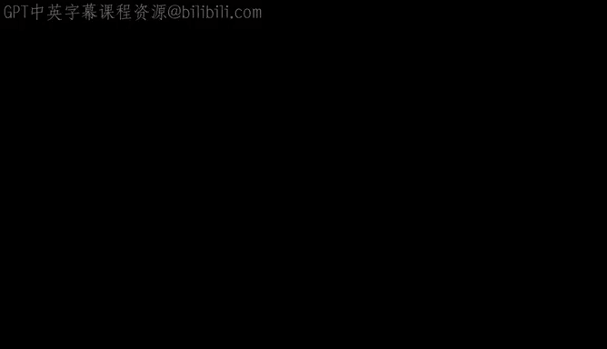

# 谷歌高阶数据分析 2：《Python入门》get-started-with-python（中英双字） - P37：37_04_04_集合简介.zh_en - GPT中英字幕课程资源 - BV1Jm4y177BW

Welcome back。 In this video， we're going to discover sets。

 A set is a data structure in Python that contains only unordered non interchangeable elements。

 Se are instantiated with the set function or non empty braces。😊。

Each set element is unique and immutable。 However， the set itself is mutable。

 Se are valuable when storing mixed data in a single rower record in a data table。

 They're also frequently used when storing a lot of elements。

 and you want to be certain that each one is only present once。 because sets are mutable。

 They cannot be used as keys in a dictionary。There are two ways to create a set。

 The first way is with the set function。The set function takes an iterable as an argument and returns a new set object。

Let's examine the behavior of sets by passing lists。

 tus and strings through the set function to turn the list containing foo， bar。

 Bas and foo into a set。 Pass a list through the set function。

 And notice the list loses the second foo。 As I've mentioned， each element must be unique in sets。😊。

Pass a tuple through the set function using two sets of parentheses。

 One to tell the computer that the data we are working with is a tuple， the other。

 because the set function only takes a single argument。 Again， the same result。

 Only one through element can be present in the set。 Finally， pass a string through the set function。

It doesn't return the string， just the singular occurrence of the letters in the string。

 O and F in an unordered way。This is because the set function accepts a single argument。

 and that argument must be iterable。 A string is iterable。

 So the set function splits it into individual characters and keeps only the unique ones。

 The second way to instantiate a set is with braces。 However。

 you have to put something inside the braces。 Otherwise。

 the computer will interpret your empty braces as a dictionary。

Note here that instantiating a set with braces treats what's inside the braces as literals。

So when instantiating a set of only a single string using braces。

 it returns a set with a single element， and the element is the string itself。Remember。

 to define an empty set or a new set， it is best to use the set function。

 You can only use curly braces when the set is not empty and you are assigning the set to a variable。

 Also， keep in mind that because the elements inside a set are immutable。

 A set cannot be indexed or sliced。 Now， let's discuss some additional functions you can use on sets。

First， intersection finds the elements that two sets have in common。

 Union finds all the elements from both sets。Difference finds the elements present in one set。

 but not the other。And symmetric difference finds elements from both sets that are mutually not present in the other。

 Python provides built in methods for performing each of these functions。

 Let's start with the intersection method denoted by the empressand。 First， define two sets。

Then apply the intersection function either by attaching the intersection method to set one and passing set two to the methods argument or by using the ampersan operator。

Great， now let's apply the union function。Use braces to define the two sets， x1 and x2。

The goal is to observe where they overlap。 print them using the union method on the X2 variable or the union operator symbol。

 Union is a communicable operation in mathematics。 So the overlapping values will be the same。

 no matter what order you put your variables in。The difference operational on sets， however。

 is not a communicable operation。Just like in math， if you subtract 5 from 7。

 you get a different result than if you subtract 7 from5。

 you can use either the difference method or the minus sign as a set operator。

Subtracting set 2 from set 1 gives us only the elements in set 1 that are not shared with set 2。

 but we don't know if set 2 contains any elements that are not shared with set 1。

 The inverse is also true。 Subtracting set 1 from set 2 gives us only the elements in set 2 that are not shared with set 1 but we don't know if set 1 contains any elements that are not shared with set 2。

 to get around this and observe the difference between two sets mutually。

 Use the symmetric difference function。 As you might have guessed。

 you can use the symmetric difference method or the symmetric difference operator expressed by a carrot。

Symsymmetric difference outputs all the elements that the two sets do not share。

Excellent work with sets and Python。 You've learned so much in this section of the course already。

 and everything you're learning is preparing you for a really rewarding career working with data。

 Can't wait to be with you soon again。😊。

