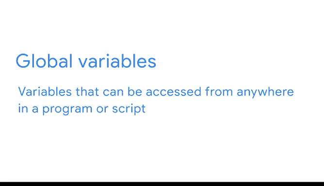

# 谷歌高阶数据分析 2：《Python入门》get-started-with-python（中英双字） - P38：38_04_01_包的强大功能.zh_en - GPT中英字幕课程资源 - BV1Jm4y177BW

Python has many advanced calculation capabilities that are used for data work and other scientific applications。

These features make it possible to extend， enhance and reuse parts of the code to access these features。

 You can import them from libraries， packages and modules。

These features are not included in basic Python， so it's necessary to add them to your scripts。

 The additional functionality can save you time， Constructing functions and objects in your own work。

Using these features can also help you obtain extra data types for analyzing data or building machine learning models。

Let's start with the libraries。 A library or package broadly refers to a reusable collection of code。

It also contains related modules and documentation。

 You'll often encounter the terms library and package used interchangeably。

 commonlyly used libraries for data work are matteplt Lib and seaborn。

Matplotlibb is a comprehensive library for creating static。

 animated and interactive visualizations in Python。

 Seaborn is a data visualization library that's based on Matplotlib。

 It provides a simpler interface for working with common plots and graphs。😊。

The certificate program integrates two other commonly used libraries for data work， Numpy and pandas。

Numpy， or numerical Python is an essential library that contains multidimensional array and matrix data structures and functions to manipulate them。

 This library is used for scientific computation。And panndadas。

 which stands for Python data analysis， is a powerful library built on top of Ny that's used to manipulate and analyze tabular data。

 There are many other popular Python libraries and packages for data professional work。

 such as Psy learn stats models and others。 Psyit learn a library and stats models。

 a package consist of functions。 data professionals can use to test the performance of statistical models。

 They're used across various scientific fields。 Psyit learnn and stats models are pretty advanced。

 So you won't be working with them in this course。 but you'll have opportunities to work with these libraries elsewhere in the program。

 Again， different practitioners across the field often conflate libraries and packages。

 So you may hear them refer to one， the other or both ways。

 libraries and packages provide sets of modules that are essential for data professionals。

 modules are。😊，Access from within a package or a library。

 they are Python files that contain collections of functions and global variables。

Global variables differ from other variables because these variables can be accessed from anywhere in a program or script。

Moddules are used to organize functions， classes and other data in a structured way。Internally。

 modules are set up through separate files that contain these necessary classes and functions。

 When you import a module， you are using pre written code components。

 Each module is an executable file that can be added to your scripts commonly used modules for data professional work。

 are math and random。Math provides access to mathematical functions。

 and random is used to generate random numbers。 This is useful when selecting random elements from a list。

 shuffling elements randomly or working with random sampling。

 which you'll explore in the later course。 There are several ways to import modules。

 depending on whether you want to use the whole package or just a single predefined function or feature。

 This adds functionality for carrying out specialized operations。

There's lots more to learn about libraries， packages and modules。

 So feel free to refer to the course resources for more information on installing these features and to continue growing your Python knowledge。

 But as a reminder， you don't have to install anything because everything you need to complete the different sections of the certificate program are already built into the notebooks you'll be using in Coursera。

 I'll introduce you to some libraries in the next video。😊。

