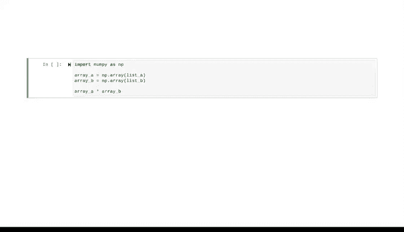

# 谷歌高阶数据分析 2：《Python入门》get-started-with-python（中英双字） - P39：39_04_02_Numpy简介.zh_en - GPT中英字幕课程资源 - BV1Jm4y177BW

You've learned that part of what makes Python such a powerful and dynamic language are the packages and libraries that are available to it。

One of the most widely used and important of these is Nmpy。

 recall that Numpy contains multidiional array and matrix data structures。

 as well as functions to manipulate them。You'll learn more about these data structures and functions soon。

 But for now， let's just consider Numpy at a high level and learn more about it。

 Numpy's power comes from vectorization。Vectctorization enables operations to be performed on multiple components of a data object at the same time。

This is particularly useful for data professionals because their jobs often involve working with very large quantities of data and vectorized code saves a lot of time because it computes more efficiently。

Let's explore this a little more。 Suppose we have list A and list B。Both the same length。

And we want to create a new list。 C。 That's the element wise product of each list。In other words。

 we want to multiply the first element of listist A by the first element of listist B。

 then multiply the second element of listist A by the second element of listist B， etc。

If we try to multiply lists A and B together， the computer throws an error。To perform this operation。

 we could write a for loop。 We'd start by defining an empty list。 list C。

 then make a range of indices to loop over and depend the product of list A and list B at each index to list C。

This gets the job done。 But if you're thinking there's got to be an easier way， you're right。

 We can use numpy to perform this operation as a vectorized computation。

Simply convert each list to a numpy array and multiply the two arrays together using the product operator。

The results are the same， but the vectorized approach is simpler。

 easier to read and faster to execute， because while loops iterate over one element at a time。

 vector operations compute simultaneously in a single statement。

 the efficiency of this might not be noticeable Now， but when working with large data sets。

 it will be。 vectorctors also take up less memory space。

 which is another factor that becomes important when working with a lot of data。

 You might have noticed that when we use nuy， we first had to import it。😊。

This is called an import statement。An import statement uses the import keyword to load an external library。

 package， module or function into your computing environment。

Once you import something into your notebook and run that cell。

 you don't need to import it again unless you restart your notebook。When we import nu piei。

 we import it as N P。 This is known as aliasing。 aliasing lets you assign an alternate name or alias by which you can refer to something。

In this case， we're abbreviating nuumpy to N P。 Notice the Ns in the code below the import statement。

 where we create our arrays。 If we didn't give Numpy an alias of N。

 we'd have to type out nuumpy here in order to access its array function。

Aliasing as N P makes the code shorter and easier to read。 Note that N P is the standard alias。

 If you use something else， other people might get confused when reading your code。

In addition to being highly useful in its own right， Numpy powers a lot of other Python libraries。

 like pandas。 So understanding how nuumpy works will help you use these other packages。

There's a lot more to discover about Numpy coming up。

 you'll learn about its core data structures and functionalities。 See you soon。

