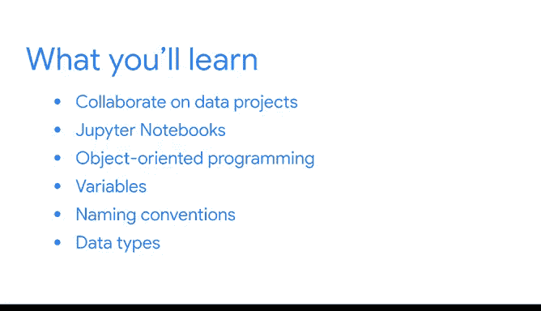

# 谷歌高阶数据分析 2：《Python入门》get-started-with-python（中英双字） - P3：03_01_05_欢迎来到模块1.zh_en - GPT中英字幕课程资源 - BV1Jm4y177BW

Hi there。 I can't wait to explore Python with you。During our journey together。

 you'll learn how to use the Python programming language to power your data analysis。

 This course will give you a foundation of essential Python skills that you can continue to build on throughout this program and your career。

We'll begin with an overview of Python's main features and capabilities and discuss the basics of Python programming。

 You'll discover how Python can help you work with your data quickly and efficiently。

Then we'll consider Jupiter Notes an interactive environment for coding and data work。

You'll learn about the useful functionality of Jupyter notebooks and how to write Python code in the notebook environment。

 Python is an object oriented programming language based on objects that contain data and useful code。

 Next， you'll explore the benefits of object oriented programming for data professionals and become familiar with its basic concepts。

 After that， you'll discover variables。 One of the building blocks of Python programming。

You'll learn how variables help you store and label your data and how to assign specific values to variables。

We'll also review the conventions or widely accepted rules for naming variables。

Learning these conventions will help you write code that is clear， precise and consistent。Finally。

 we'll explore fundamental data types， such as integers， floats and strings。

 You'll learn how to convert and combine data types to organize your data。😊。

When you're ready， join me in the next video。