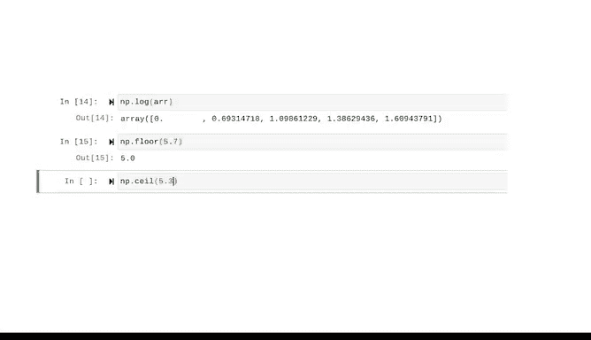

# 谷歌高阶数据分析 2：《Python入门》get-started-with-python（中英双字） - P40：40_04_05_基本数组操作.zh_en - GPT中英字幕课程资源 - BV1Jm4y177BW

Welcome back。 You recently learned that the Numpy Library uses vectorization to make working with data faster and more efficient。

 which makes your job easier。 I demonstrated how Numpy performed an element wise multiplication of two lists by converting the lists to arrays and then simply multiplying them together。

😊，Now we're going to continue learning about arrays and how to work with them。

The array is the core data structure of Nmpy。 The data object itself is known as an n dimensional array or N D array for short。

 The N D array is a vector。 recall that vectors enable many operations to be performed together when the code is executed resulting in faster run times that require less computer memory。

 You can create an N D array from a Python object by passing the object to the NP array function。😊。

ND arrays are mutable， so you can change the values they contain。

If I want to change this last value from a4 to a5， I can do that by identifying the index number。

Since we're dealing with the last value here， it's necessary to use a negative one。

But I can't change the size of the array without reassigning it。

 If I try to add a number to the end of this array， the computer throws an error。

 So if you want to change the size of an array， you have to reassign it。

Another requirement of the array is that all of its elements be of the same data type。

If I create an array with the integers 1，2， and then a string of cocoanut。

 Numpy will create an array that forces everything to the same data type， if possible。In this case。

 everything becomes a string represented here by U 21， meaning Unicode 21。

So be careful when creating your arrays that they all contain data of the same type。

 or if they don't， that this is intentional and useful to what you're doing。

You previously learned that calling the type function on an object will return the data type of the object。

If we do that with an array， as you might expect， we get a numpy array。

We can use the D type attribute if we want to check the data type of the contents of an array。Here。

 the D type attribute indicates that this array consists of integers。As the name implies。

 ND arrays can be multidimensional。For a one dimensional array。

 Numpy takes an array like object of length X， like a list and creates an N D array in the shape of x。

A one dimensional array is neither a row nor a column。

We can use the shape attribute to confirm the shape of an array。

We can also use the end dimmed attribute to confirm the number of dimensions the array has。

Data professionals will often need to confirm the shape and number of dimensions of their array。

 For example， if they're trying to attach it to another existing array。

 these methods are also commonly used to help understand what's going wrong when your code throws an error。

 A two dimensional array can be created from a list of lists where each internal list is the same length。

You can think of these internal lists as individual rows。 So the final array is like a table。

 Notice that this array has a shape of four rows by two columns and is two dimensions。

If a two dimensional array is a list of lists， then a three dimensional array is a list that contains two of these。

 so a list of two lists of lists。This array can be thought of as two tables。

 each with two rows and three columns。 Thus， it has three dimensions。This can go on indefinitely。

 Thankly， there are ways to help simplify working with multidimensional arrays。

 which you'll learn about later。😊，And unless you're doing very advanced scientific computations。

 you typically won't be working directly with nuy arrays that are more than three dimensions。

Numpy also lets us reshape an array using the reshape method。

Our two dimensional array was four rows and two columns。

But what if we wanted this data to be two rows by four columns。

We just plug these values into the reshape method and reassign the result back to the array to D variable。

Reshaping data is a common task in data analysis。 So it's important for you to be familiar with what it means and how it works。

 There are many other operations that can be performed with array arrays。

 and you'll surely learn those as the need for them arises in your projects。

 But there are other helpful functions and methods and nuy that you'll use regularly。

 These include functions to calculate things like mean and natural logarithm and floor and sailing operations which round numbers to the nearest lesser and greater whole number respectively。

And many other frequently used mathematical and statistical operations。

Numpy is very robust。 There are so many things you can do with it that we can only briefly consider them here。

 As you know， Numpy powers many other useful libraries and packages。😊，In this certificate program。

 we won't be working a lot directly with nuumpy， but we will be working a lot with the library that depends on it。

 Padas， it's important that you understand the basics of numpy because it will help you when you start working with pandas。

As you develop your skills as a data professional， you'll find yourself returning to Numpy time and time again because it's such an integral part of advanced data analysis。

Bye for now。