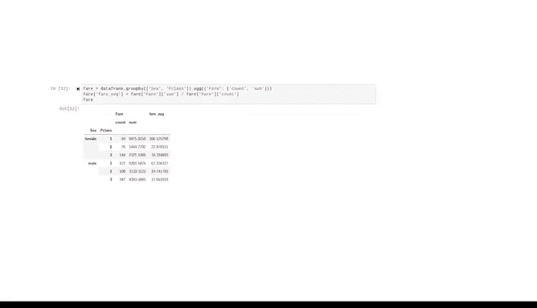

# 谷歌高阶数据分析 2：《Python入门》get-started-with-python（中英双字） - P41：41_04_01_Pandas简介.zh_en - GPT中英字幕课程资源 - BV1Jm4y177BW

Hi there。 We've previously discussed Nmpy and how it's an important tool for data professionals and anyone one else whose job requires high performance computational power。

 We also investigated how other libraries and packages use Numpy because of the efficiencies that come with vectorization。

 One of these libraries is pandas。 A quintessential tool both in this certificate program and in the world of data analytics。

 In this lesson， you're going to learn more about pandas and why it's so useful。😊。

Because pandas is a library that adds functionality to Python's core tool set。 You have to import it。

 similar to how we imported Nmp as N P。 Padas has its own standard alias of P D。 Typically。

 when using pandas， you import both numpy and pandas together。 This is just for convenience。

 Given that numpy is often used in conjunction with pandas。Strictly speaking。

 you don't have to import Numbai to work in pandas。 Padas is fully operational on its own。

Pendnda's key functionality is the manipulation and analysis of tabular data。

 That is data that's in the form of a table with rows and columns。

 A spreadsheet is a common example of tabular data。

While Ny is capable of many of the same functions and operations as pandas。

 it's not always as easy to work with because it requires you to work more abstractly with the data and keep track of what's being done to it。

 Even if you can't see it。 Padas， on the other hand。

 provides a simple interface that allows you to display your data as rows and columns。

 This means that you can always follow exactly what's happening to your data as you manipulate it。

 In this video， I'll give you a demonstration of pandas and what it's like to use it。Later。

 we'll go into greater detail on its unique classes， processes， and functions。First of all。

 you can load data into pandas easily from different formats like comma separated value files or Cvs。

 Excel and other spreadsheets， databases and more here。

 I'm loading a CSV file that I'm accessing via a web URL。

 The file contains information for some of the passengers from the Titanic， I their names。

 What class ticket they had， their age， ticket price and cabin number。 By the way。

 this table of data is called a data frame。 The data frame is a core data structure and pandas。

 Notice that the data frame is made up of rows and columns。

 and it can contain data of many different data types， including integers， floats， strings。

 Booleans and more。😊，If I want to calculate the average age of the passengers。

 we do so by selecting the age column and calling the mean method on it。I can also get the max。Min。

And standard deviation with minimal effort。I can also quickly check how many passengers were in each class。

Checking summary statistics of the entire dataset set only requires one line of code。

 This method gives you the number of rows， as well as the mean standard deviation。

 minimum and maximum values， along with the quartiles for every numeric column。

These concepts are all covered in greater depth elsewhere in the program。 For now。

 I just want you to pay close attention to the power of pandas and all that you can accomplish with it。

😊，Paandndas also allows me to filter based on simple or complex logic。 For example。

 hear I selecting only the third class passengers who were older than 60。

In addition to all of these data analysis tools， Padas also gives us ways to manipulate and change the data。

For example， I can add a column that represents the inflation adjusted price of a ticket from 1912 to 2023。

 Florence Briggs fire paid 71，28 for her first class ticket Today day。

 that ticket would have cost her 10417 sterling。If you're wondering how I knew her name was Florence Bri's Fair。

 It's because I can also select rows， columns or individual cells from the data using indexing。

 Her name is in row 1， column 3。I can also do more complex data groupings and aggregations。

 For example， here I'm grouping the passengers by class and sex。

 and then calculating the mean cost of a ticket for each group。

Hopefully， you're excited to start working with pandas。

 I know I'm looking forward to guiding you as you learn more about this powerful and fun data analysis tool。

😊。