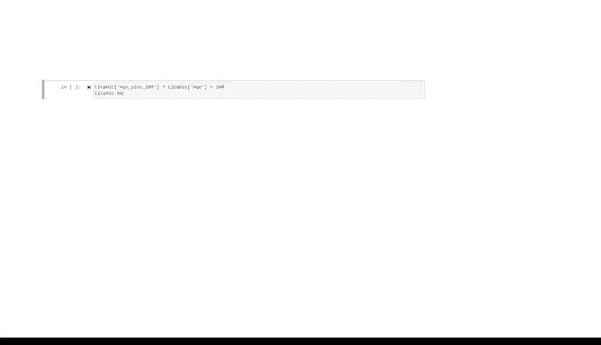

# 谷歌高阶数据分析 2：《Python入门》get-started-with-python（中英双字） - P42：42_04_02_Pandas基础.zh_en - GPT中英字幕课程资源 - BV1Jm4y177BW

Now that you have a good understanding of the course structures and routines of Python and some of the basics of numpyy。

 youre ready to start working with pandas。 Padas is one of the primary tools that you'll use throughout the rest of the certificate program。

 as well as in a large and growing number of data professions。😊，In this video。

 you'll learn about the main classes in the Padas Library and some important ways to work with them。

 Pandas has two core object classes， data frames and series。😊。

Let's begin with the review of data frames。 A data frame is a two dimensional labeled data structure with rows and columns。

 You can think of a data frame like a spreadsheet or a SQL table。

 It can contain many different kinds of data。 Data professionals use data frames to structure。

 manipulate and analyze data and pandas， just like we did in the previous video with the Titanic example。

We can create a data frame using the pandas data frame function。

 This function has a lot of flexibility and can convert numerous data formats to a data frame object。

In this example， we created a data frame from a dictionary where each key of the dictionary represents a column name。

 and the values for that key are in a list。Each element in the list represents a value for a different row at that column。

We can also create one from a nuumpy array， resembling a list of lists where each sublis represents a row of the table。

Notice that in this example， we included separate keyword arguments for columns and index。

This approach lets us name the columns in rows of the data frame。

These are just a couple of the many different ways to create a data frame with the data frame function。

For examples of some others， be sure to review the available pandas documentation on this topic。

 Often data professionals need to be able to create a data frame from existing data that's not written in Python syntax。

For example， maybe we want to take an existing spreadsheet and manipulate it in pandas。

 Spreadsheets can be saved as CSV files， which can then be read into pandas as a data frame。

CSV stands for comma separated values， and it refers to a plain text file that uses commas to separate distinct values from one another。

Here is a sample of the first few lines of a source data from the Titanic data set that we used previously。

This is what a CSV file looks like。In this file， you'll find values for passenger name， age， sex。

 fair， and more。Notice that a comma is used to separate each value from the next。

To create a data frame from a CSV file， Padas has the read CSV function。

Here's the same Titanic data rendered as a data frame。For the sake of an example。

 it's defined here as D F 3。The Read CSV function can read files from a URL， like in this example。

 and it can also read files directly from your hard drive。Instead of a URL。

 you just provide the file path to your file。Now， let's discuss the other main class in pandas series。

A series is a one dimensional labeled array。Series objects are most often used to represent individual columns or rows of a data frame。

So if we select a row or a column from this Titanic data frame and call type on it。

 it will return as a pandas series object。Like data frames。

 individual series can be created from various data objects， including from numpy arrays。

 dictionaries and even scholars。 Again， refer to the penix documentation for examples。Now。

 let's use the Titanic data set to review some of the basics of working with data frames in series。

The data frame and series classes have many super useful methods and attributes that make common tasks easier。

Remember， a method is a function that belongs to a class。It performs an action on the object。

An attribute is of value associated with a class instance。

It typically represents a characteristic of the instance。

Both methods and attributes are accessed using dot notation， but methods use parentheses。

 while attributes do not。Earlier in the video， we named the Titanic data set D F 3。

 But let's change the name to Titanic for clarity。We can do this by simple reassignment。

If we want to access the columns of the data frame， we can use the columns attribute。

This returns an index of all of the column names。We can use this shape attribute to check the number of rows and columns contained in the data frame。

This data frame has 891 rows and 12 columns。And we can get some summary information about the data frame by calling the infofo method。

 This tells us that there are 891 rows and 12 columns， and it also gives us the column names。

 the data type contained in each column， the number of non null values in each column。

 and the amount of memory the data frame uses。😊，By the way。

 I want to address a couple of points about terminology and pandas。First。

 no values and pandas are represented by N A N， which stands for not a number。And second。

 if a series object contains mixed or string data types， when you check its data type。

 it will come back as an object。This is an example of how pandas is built on nuumpy。

 but the details of this are beyond the scope of this video。

One of the most common tasks when working in pandas is selecting or referencing parts of the data frame。

 This has many similarities with indexing and slicing。For example。

 if you want to select a single column， you can type the name of the data frame followed by brackets。

And within the brackets， enter the name of the column as a string。

This returns a series object of that column。You can also use that notation。

 but this only works if the column name does not contain any white spaces。

Using dot notation is faster to type， so for very simple lines of code， you may prefer to do this。

 but if the code begins to get more complex， it's generally better to use bracket notation because it makes the code easier to read。

To select multiple columns of a data frame by name， use bracket notation。Within the brackets。

 enter a list of column names。This returns a view of your data frame as a new data frame object。

If you want to select rows or columns by index， you'll need to use I Lo。

I log is a way to indicate in pandas that you want to select by integer location based position。

 If you enter a single integer into the I look brackets。

 you'll get a series object representing a single row of your data frame at that index。😊。

Because I entered zero here， I got the very first row in my data frame as a series。

If you enter a list of a single integer in the IL brackets。

 you'll get a data frame object of a single row of the data frame at that index。

You can access a range of rows by entering the indices of the beginning and ending rows separated by a colon。

Painers will return every index， starting with the beginning index up to。

 but not including the last index。So zero colon 3 returns row indices 0，1， and 2。

You can select subsets of rows and columns together， too。This returns a data frame view of rows 0。

1 and 2 at columns 3 and 4 only。So if you want a single column in its entirety。

 you select all rows and then enter the index of the column you want。

And you can even get a single value at a particular row in a particular column by using two indices separated by a comma。

Loke is similar to IL， but instead of selecting by index location。

 Lo is used to select pandas rows and columns by name。

Let's investigate Lope with the Titanic data frame。In this example， I'm selecting rows1， two。

 and three at just the name column。Note that in this example。

 we're referring to the rows with numbers， even though we're using Lo to select。

This is because our rows are indexed by number。If we had a named index， however。

 we'd have to use row names like what we're doing for columns。And one more thing。

If you want to add a new column to a data frame， you can do that with a simple assignment statement。

Now， we have a new column at the end here。There are so many things you can do in banddas。

 and I can only share so much in the time we have， As always， the documentation is your friend。😊。

There will inevitably be times where you need to do something that wasn't explicitly covered here。

 In those cases， the documentation almost always has simple examples that demonstrate how to do the thing you need to do。

There's still more to come though， so I'll meet you soon。

