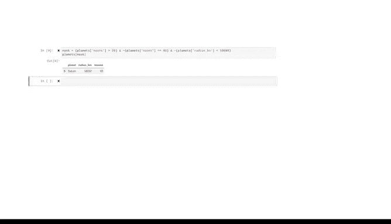

# 谷歌高阶数据分析 2：《Python入门》get-started-with-python（中英双字） - P43：43_04_04_布尔掩码.zh_en - GPT中英字幕课程资源 - BV1Jm4y177BW

Previously， we investigated several different ways of selecting data in a data frame。

 including column selection， row selection and selection of combinations of rows and columns using name based and integer based indexing。

😊，In this video， you'll learn how to filter the data in a data frame based on value based conditions。

You know that Boolean is used to describe any binary variable with two possible values。

 true or false。With pandas， you can use a powerful technique known as Boolean masking。

Bulolean masking is a filtering technique that overlays a boolean grid onto a data frame in order to select only the values in the data frame that align with the true values of the grid。

Data professionals use Boolean masking all the time。

 so it's important that you understand how it works。Here's an example。

 Suppose you have a data frame of planets， the ra eye and the number of moons each planet has。Now。

 suppose that you want to keep the rows of any planets that have fewer than 20 moons and filter out the rest。

 A Boolean mass is a pandacese object， indicating whether this condition is true or false for each value in the moon's column。

The data contained in this series is type Boole。 Boolean masking effectively overlays this Boolean series onto the data frames index。

The result is that any rows in the data frame that are indicated as true in the Boolean mask remain in the data frame。

And any rows that are indicated as false get filtered out。

Here's how to perform this operation in pandas。We'll begin by creating a data frame from a predefined dictionary using the pandas data frame function。

 The data frame is called planets。The next step is to create the Boolean mask by writing a logical statement。

 Remember， the objective is to keep planets that have fewer than 20 moons and to filter out the rest。

 So we define the mask by writing planets at the moon's column is less than 20。

This results in a series object that consists of the row indices。

 where each index contains a true or false value， depending on whether that row satisfies the given condition。

 This is the Boolean mask。To apply this mass to the data frame。

 insert it into selector brackets and apply it to the data frame。

It's also possible to apply the conditional logic directly to the data frame。

 skipping the part where we assign it to a variable named mask。

 but breaking out the steps individually can make the code easier to follow。

Note that we haven't permanently modified the data frame。 Apping the Boolean mask。

 using the conditional logic only gives a filtered view of it。

 So when you call the planet's variable again， it returns the full data frame。However。

 we can assign the result to a name variable。 This may be useful if you'll need to reference the list of planets with moons under 20 again later。

Sometimes you'll need to filter data based on multiple conditions。

Pands uses logical operators to indicate which data to keep and which to filter out and statements that use multiple conditions。

These operators are the Emorand for and， the vertical bar for ore， and the Tilda for n。

Let's review how this works。 Here's how to create a Boolean mask that selects all planets that have fewer than 10 moons or greater than 50 moons。

 Notice that each condition is self contained in a set of parentheses。

 and the two conditions are separated by a vertical bar。

 which is the logical operator that represents ore。

It's very important that each component of the logical statement be in the parentheses。 Otherwise。

 your statement will throw an error or worse return something that isn't what you intended。

To apply the mask， call the data frame and put the statement or the variable it's assigned to in selector brackets。

Here's an example of how to select all planets that have more than 20 moons。

 but not planets with 80 moons and not planets with a radius， less than 50000 kilometers。

Let's break it into pieces。 First is the statement for planets。In parentheses。

 we put planets at the moon's column must be greater than 20 and close the parentheses。

 Then we use the and not operators before parentheses。

 Plans at the moon's column equals 80 close parentheses。

 Then we again use the and not operators before parentheses。 Plans at the radius column。

 Le than 50000 close parentheses。😊，When we apply the mass to the data frame。

 we're left with just one planet， Saturn with 83 moons and a radius of 58232 km。

There are a near infinite number of ways to select and filter data using the basic tools that you've learned so far。

 As always， it takes a lot of practice before you know exactly how to execute every selection statement that your work requires。

 So make sure to bookmark any and all resources that you find helpful to reference。😊。

Keep up the good work， and I'll meet you in the next video。

