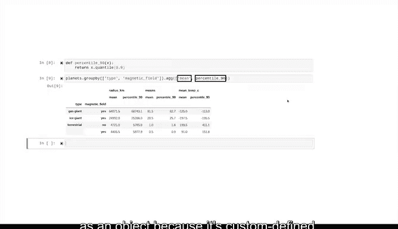

# 谷歌高阶数据分析 2：《Python入门》get-started-with-python（中英双字） - P44：44_04_06_分组与聚合.zh_en - GPT中英字幕课程资源 - BV1Jm4y177BW

Now that you've learned how to select and filter data using name and location based indexing。

As well as Boolean masking， it's time to take the next step。In this video。

 you'll learn how to group your data， aggregate it and perform calculations on these groupings to help you discover what the data is telling you。

 One of the most important and commonly used tools to group data in pandas is the group by method。😊。

Group I is a pandas data frame method that groups rows of the data frame together based on their values at one or more columns。

 which allows further analysis of the groups。Let's return to our planet's data set to demonstrate some different ways to use the group by method。

This time， we'll add a little more data， including the type of planet。

 whether or not it has a ring system， average temperature in degrees Celsius。

 and whether or not it has a global magnetic field。 As always， when learning a new data tool。

 it's helpful to begin by applying it to a small example。

 This will better enable you to understand exactly what's happening。 First。

 let's examine the mechanics of what happens when you use group by。

 when you call the group by method on a data frame， it creates a group by object。😊。

If you do nothing else， the group by object isn't very helpful。

 You'll basically get a statement saying， here's your object。 It's stored at this address。

 in the computer's memory。But once you have this object。

 there are all kinds of things you can do with it。For example。

 if we group the data frame by the type column and then apply the sum method to the group by object。

 the computer returns a data frame object with three rows， one for each planet type。

 and three columns， one for each numerical column。Only the numerical columns are returned because the sum method only works on numerical data。

 The type column is an index of this data frame。This information can be interpreted as the sum of all the values in each group at these respective columns。

So， for example， ra eye of all the gas giant planets， some to 128143 km。

That information probably isn't very useful in most cases。

 but the total number of moons could definitely be something we want to calculate。

 If you want to isolate the information at particular columns。

 just insert the columns as a list in selector brackets following the group by statement。

You can also use other methods instead of some。 For example， min， Max， mean， median。

 count and many others。Group I will work on multiple columns， too。

 When we pass a list containing the type and magnetic field columns to the group by method and then apply the mean method to the result。

 we get a data frame that contains a row for each unique combination of planet type and magnetic field。

 Again， the columns contain the mean calculated values for each numerical column for each group。😊。

Group by is very useful because it helps you to better understand your data。

It's also useful to organize data that you want to plot on a graph。 You'll learn more about this。

 later。Another important method to use on the group by objects is the Ag method。

Ag is short for aggregate。 This method allows you to apply multiple calculations to groups of data。

Let's start simple。What if we want to group the planets by their type and then calculate both the mean and the median values of the numeric columns for each group？

We call the Ag method after the group by statement。In its argument field。

 we enter a list of the calculations we want to apply to the data。

If these calculations are existing methods of group by objects， they can just be entered as strings。

We can group by multiple columns and apply multiple aggregation functions to each group。For instance。

 we can group the planets by type and whether or not they have a magnetic field and then use the ag method to calculate the mean and max values of each group。

And we can even define our own functions， and apply them。For example。

 suppose we want to calculate the 90th percentile of each group。

We can define a function called percentile 90 that uses the quantile method on the array and returns the value at the 90th percentile。

 Then we can call this custom function in our aggregation。

Notice that we can enter mean as a string because it's an existing method of group by objects。

 but we type the percentile 90 function as an object because it's custom defined。

Group by and aggregate are two tools that together can give deep insight to the story that your data is telling you。

The types of calculations that we just viewed are daily tasks of data professionals in nearly every field。

Even though we only applied them to a very tiny data set。

 the same exact operations would work on a data set of every planet in the galaxy。

 If we knew them all and if we had enough computing power to perform the aggregations。

 There's a lot more we can do with group by an aggregate。 And as always。

 I encourage you to explore more in your own。 But you should now have a solid understanding of how and when to apply these tools。

😊。