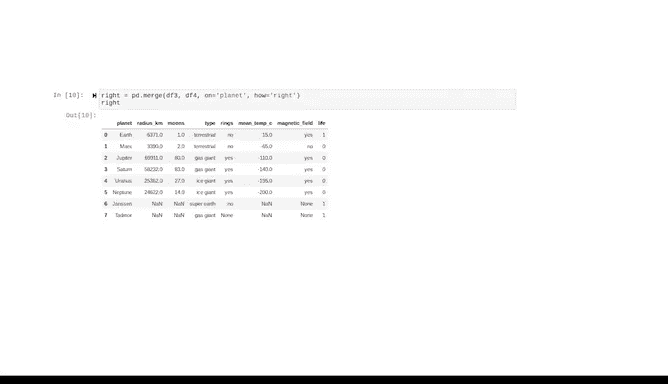

# 谷歌高阶数据分析 2：《Python入门》get-started-with-python（中英双字） - P45：45_04_08_数据合并与连接.zh_en - GPT中英字幕课程资源 - BV1Jm4y177BW

Hello again， you've learned a lot about pandas that it's a powerful library that makes working with tabular data easier and more efficient。

 how to select an index data in a data frame， how to filter data using Boolean masks。

 and how to group and aggregate data to derive insights from the story it's telling。In this video。

 you'll learn how to add new data to existing data frames。

 This is a common task for data professionals。 but it's not as simple as just adding two data frames together。

 There are important considerations to be aware of by the end of this lesson。

 you'll have a good understanding of what these considerations are。

 So you can make informed decisions about how best to add data to your project。

We're going to learn about two pandas functions。 can cat and merge。

 There's considerable overlap between the capabilities of these functions。

 but it's most important that you learn the basics of each。

 because you will encounter them regularly as a data professional。😊。

We'll start with the concatet function。 Rell that to concatenate means to link or join together。

 The pandas concat function combines data either by adding it horizontally as new columns for existing rows or vertically as new rows for existing columns。

 It's also capable of handling many data specific complexities that arise。

 which allows for a high degree of user control。 In this video。

 I'll demonstrate how to use the concatet function to add new rows to existing columns。 But remember。

 there's plenty of support documentation。 if you like additional information。😊。

Pdas has a specific way to indicate which way we want the data to be concatenated。

 We do this by referring to axes。 In fact， many pandas and numpy functions have an axes keyword。

 So you can specify whether you want to apply the function across rows or down columns。

 The two axes of a data frame are 0， which runs vertically over rows， and one。

 which runs horizontally across columns。We'll use our basic planet's data set to demonstrate how Kcat works。

This data has four planets， the ra eye， and the number of moons。

 but it's missing the data for Jupiter， Saturn， Uranus and Neptune。 Now。

 suppose we want to add this data， which exists as a separate data frame。

Let's examine this second data set with information about Jupiter， Saturn， Uranus。

 and Neptune before joining them。Notice that this data is in the same format as the data in the DF1 data frame。

 It has the same columns for planet， radius and moons to combine the two data frames will want to add Df2 as new rows below DF1。

To concatenate the first data set with information about mecury， Venus， Earth and Mars。

 with the second， which has information about Jupiter， Saturn， Uranus， and Neptune。

 we call PD conca and insert a list of the data frames we want to concatenate。

Then we need to include an Axes keyword argument。This instructs the function to combine the data either side by side or one on top of the other。

We want our resulting data frame to have eight rows and three columns。

 which means we want to combine the data vertically。In other words。

 we want to add new data by extending axes0， the vertical axes。Perfect。

 the data was added as new rows， notice that each row retains its index number from its original data frame。

If you want the numbering to restart， just reset the index。

 we can include the drop equals true argument because otherwise a new index column will be added to the data frame。

 which we don't want in this case。Now， the enumeration of the ro indices goes from 0 to 7。

The concat function is great for when you have data frames containing identically formatted data that simply needs to be combined vertically。

 If you want to add data horizontally， consider the merge function。😊。

The mergech function is a pandas function that joins two data frames together。

 It only combines data by extending along axes 1 horizontally。Let's return to the planets。 Now。

 we have the radius and number of moons for all eight planets。

 but suppose we want to add the data for the planet type， whether it has rings。

 its average temperature， whether it has a magnetic field and whether it has a life on it。😊。

Perhaps this data exists as a separate data frame， but it's missing Mercury and Venus。

 and it has some recently discovered planets from other star systems， Jansen and Tadmore。

 That's okay。 We can still work with this。First， let's conceptualize how data joins work for two data sets to connect。

 They need to share a common point of reference。 In other words。

 both data sets must have some aspect of them。 That is the same in each one。 These are known as keys。

 Keys are the shared points of reference between different data frames。 What to match on。

 In our case， the keys are the planets。 Each data frame contains planets for us to match on。Now。

 let's consider the different ways that we can join this data。We can join it。

 So only the keys that are in both data frames get included in the merge。

 This is known as an inner join。Alternatively， we can join the data so all of the keys from both data frames get included in the merge。

 This is known as an outer join。We can also join the data。

 So all of the keys in the left data frame are included， even if they aren't in the right data frame。

 This is called a left join。Finally， we can join the data。

 So all the keys in the right data frame are included。 Even if they aren't in the left data frame。

 This is called a right join。 Let's examine how each type of join affects our planet data。 First。

 we'll call the function and enter D F 3 and D F4 as the left and right positional arguments respectively。

 Then we include the keyword argument on。 which lets us specify what our keys to match on should be。

 In this case， we want to use the planet column。😊，Now， we have the how key word argument。

 This is where we enter the kind of join we want。 Let's try inter first。

This merged the data and only kept the planets that appeared in both data frames。

 This means re missing data from mercury and Venus from the left data frame。

 as well as for Jansen and Tadmore from the right data frame。Now， let's try and outer join。

Our function call will remain the same， except for the Hkey word argument， which will set to outer。

As expected， this results in a data frame that contains all the keys from both initial data frames。

 noticeice that because Jansen and Tadmore aren't in the left data frame。

 they don't have information for radius and moons。 So these columns get filled with N A Ns。

 Similarlyly， because mercury and Venus aren't in the right data frame。 They， too。

 are missing some information in the final table， which is represented by N A Ns。Next。

 we'll do a left drawing。 Again， the function gets the same syntax except for the how argument。

 which is set to left。This results in a data frame that retains all the keys from the left data frame and only the keys from the right data frame that exists in the left data frame too。

 So Jansen and Tadmore are excluded。Finally， we'll perform a right join。As expected。

 the result is a data frame that has all the keys from the right data frame。

 but none of the keys from the left that weren't also in the right。

 So mercury and Venus are excluded。

Nice job。 Now that you know the fundamentals， you can use these pandas tools to do the most common kinds of data joins。

 which will be useful for a wide variety of data projects。 And as you advance your career。

 you'll discover even more about joining data and how it can get very complex。

 These tools will be a big help as you do。 You've come a long way。

 and we are now ready to start using pandas to explore your data like a true data professional。

 See you soon。😊。