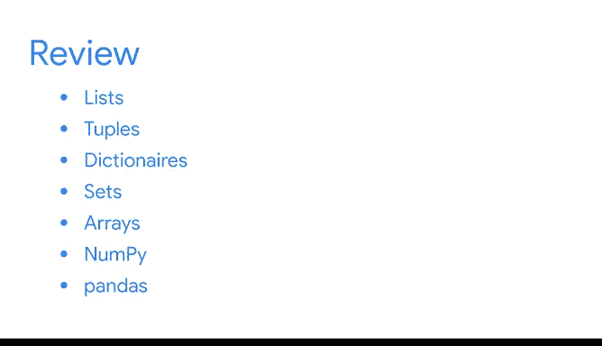

# 谷歌高阶数据分析 2：《Python入门》get-started-with-python（中英双字） - P46：46_04_01_总结_4.zh_en - GPT中英字幕课程资源 - BV1Jm4y177BW

This is the end of the fourth section of the Python course。

You now have a strong foundation of Python skills that you can continue to build on throughout your future career as a data professional In this section of the course。

 you learned how data professionals use data structures to store， access and organize their data。

 Understanding which data structures fit your specific task is a key part of data work and will help you analyze your data with speed and efficiency。

 We reviewed fundamental data structures that are super useful for data professionals。 Ls， tus。

 dictionaries， sets and arrays。😊，We also discussed two of the most widely used and important Python tools for advanced data analysis。

 The first was Nmpy， which data professionals use for its computational power。

 You learn how Numpy can help you rapidly process large amounts of data and perform useful calculations。

 The second Python tool you learned about was pandas。

 which is a powerful tool for analyzing tabular data。😊。

You learn how pandas can help you perform key tasks such as filtering， grouping and merging data。

Data professionals often work with tabular data。 You'll use pandas throughout the rest of the certificate program and your future career。

Coming up， you have a greeted assessment。To prepare。

 review the reading that lists all the new terms you've learned and feel free to revisit videos。

 readings and other resources that cover key concepts。Congratulations on all your progress。

 way to go。