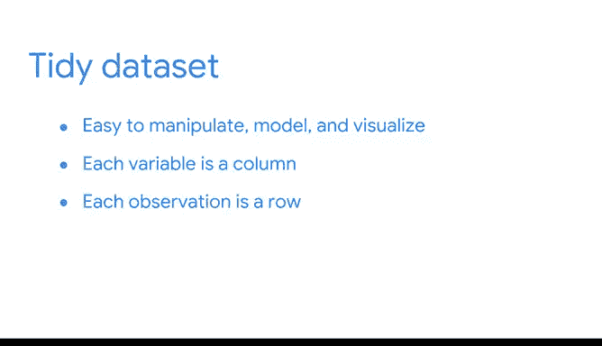

# 谷歌高阶数据分析 2：《Python入门》get-started-with-python（中英双字） - P47：47_05_01_欢迎来到模块5.zh_en - GPT中英字幕课程资源 - BV1Jm4y177BW

Hi， it's great to be with you again。You might recognize me from the last course。 I'm Tiffany。

 and I lead the responsible AI program management team here at Google。

I'm back to talk more with you about your portfolio projects and how you can use them in your job search。

Now that we've had some time to explore Python， I'm excited to help you work on a project that you can add to your professional portfolio。

As we complete the segment of the program， you'll have the opportunity to begin showcasing your coding skills。

This portfolio project is a really valuable opportunity to develop your interview skills。

When potential employers assess you as a candidate。

 they might ask for specific examples of how you tackled coding challenges in the past。

You could use your portfolio as a way to discuss a real problem you have solved。Additionally。

 some employers might ask you to load， clean and structure data during an interview to prove your proficiency。

Getting in practice creating a database structure to address data driven projects means you'll be prepared for that type of situation。

You have already learned about experiential learning or the idea of understanding through doing。

This portfolio project is a great opportunity to really discover how organizations manage data with Python and practice the skills you've been learning in this course。

To complete the portfolio project， you'll be presented with details about some business cases and some unstructured data files。

Choose one business scenario and use the instructions to complete a new entry in your pay strategy document based on the scenario。

 your task is to load， clean and structure the data so that your end product is a tidy data set Data tiing is structuring data sets to facilitate analysis。

Tidy data sets are easy to manipulate， model and visualize， and have a specific structure。

Each variable is a column。Each observation is a row， and each type of observational unit is a table。

By the time you complete this project， you'll have a structured data set that you'll use in the next course portfolio project in your pay strategy document。

 you'll also have documentation of the steps you took along the way。

 which you can use to explain your work and thought process to future hiring managers。At this point。

 you're almost finished with this course， which means you've learned everything you need to keep advancing as a data professional。

 This part of the project will focus on demonstrating mastery of data manipulation and understanding how data professionals use Python to explore and extract information through custom functions。

Ready。Then let's get started。

