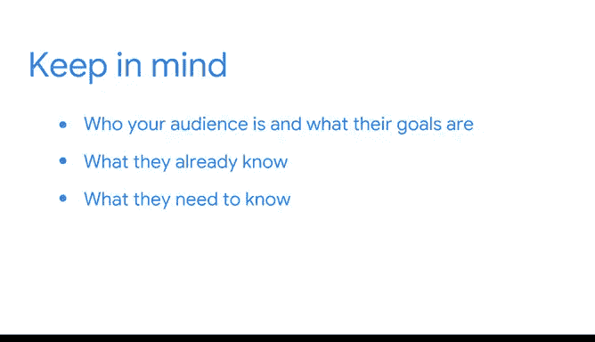

# 谷歌高阶数据分析 2：《Python入门》get-started-with-python（中英双字） - P49：49_05_01_期末项目总结与职业持续成功建议.zh_en - GPT中英字幕课程资源 - BV1Jm4y177BW

Hi there。Let's take a moment to appreciate how far you've come at this point in the program。

 You've done a lot of work already。 You completed two entries in your pay strategy document and began writing your own code。

As you continue to work on your portfolio projects。

 you will want to consider how you can document your process and explain what you've done to potential employers and hiring managers in future interviews。

First， it's important to recognize that as a data professional。

 you may be asked to learn and adapt to new tools。 There are a lot of great options out there and different businesses have their own preference depending on their needs。

 as you apply for jobs， Keep in mind that you have learned a lot of transferable skills that can be applied across organizations and industries For example。

 in the part of your portfolio project you just completed you use Python to build a tidy database。

 focus on solving a data focused business scenario。Python is a great tool。

 and knowing how to use it is a tremendous skill， but even more importantly。

 you've learned to consider how a data professionals' work contributes to business decisions and strategic insights。

You've learned the importance of communication， the value of tools available to you。

 and how to use Python to manage large data sets。These are skills worth highlighting in job interviews。

 no matter what tools the position requires。This portfolio project is a great way to showcase these transferable skills and give interviewers insight on your approach to problems。

 your thought processes， and why you made certain decisions。

In addition to making sure you're highlighting transferable skills when talking about your portfolio project。

 you'll also want to make sure you're considering your audience。

As you have been learning throughout these courses。

 you will often work with different kinds of stakeholders who have different levels of technical knowledge when you're communicating with them about technical processes。

 youll want to keep in mind who your audience is， what their goals are， what they already know。

 and what they need to know。

This is just as true when you're discussing your portfolio project with interviewers。

Often there will be people conducting or joining your interview who aren't necessarily data professionals。

 for example， hiring managers may not have the same detailed understanding of data processes as you do。

In order to keep your presentation relevant to them。

 try to remember those key questions about your audience。Your interviewers have a business challenge。

 just like stakeholders and data projects。They have an open job position they need to fill。

Think about what they need to know about you to make a decision that solves that challenge。Coming up。

 you're going to learn all about how to tell stories with data。

 Then you'll have an opportunity to perform some exploratory data analysis and create data visualizations。

 By the end of the program， you will have a strong portfolio。

