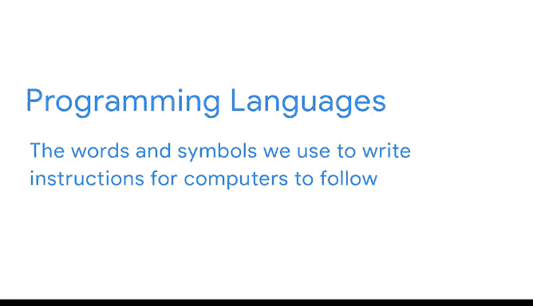
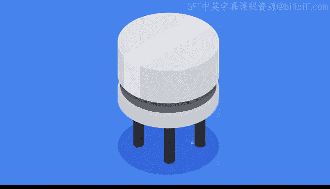
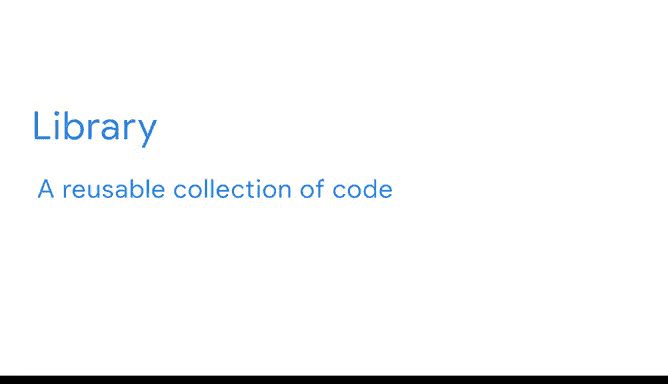

# 谷歌高阶数据分析 2：《Python入门》get-started-with-python（中英双字） - P4：04_01_06_Python入门.zh_en - GPT中英字幕课程资源 - BV1Jm4y177BW

Python is a powerful coding language that has become one of the preferred tools of data professionals worldwide。

 and for good reason。In this video， we'll explore what Python is and why it has become so popular。

 But first， let's discuss some basic elements of programming languages in general。

 programminging languages originated with the development of electronic computers。

 They were and still are The words and symbols that we use to write instructions for computers to follow。

 Communicating with the computer ultimately relies on computer hardware。

 A transistor is the most fundamental component of the computer because it controls the flow of electricity through a circuit。

😊。

A transistor can exist in two states on or off， like a switch。 When a transistor is on。

 electricityity passes through it。 when it's off， it blocks the electricity。

 This duality defines how computers operate。😊。

If you chain enough transistors together each either on or off， you can create complex logic。

 So how does this relate to computer programming？ Well。

 because computers are just billions of transistors or switches。

 they understand things only in binary terms。 You may have encountered this concept before。

 binaryary binary is represented as ones and zeros。

 These numbers are just an easier way to refer to the on and off sequences of transistors when a computer receives instructions from a program。

Computers are powerful， but they still need to be given instructions。

 and they can only understand instructions that are given in binary。

The engineers who first designed computers encountered this and discovered a problem。

 Computers are great at understanding binary。 Humans are not。

 This problem is what gave rise to the first programming languages。

 The very first programming languages were difficult to use。 required lots of training。

 and often only worked on the specific machine that each was designed for。

 These types of languages are known as low level languages Over time。

 new coding languages developed to simplify and generalized programming instructions。

 The programming languages became easier to learn because they were designed with simpler rules and structures known as syntax。

 Mo programming languages use syntax that's much more familiar to humans。

 These languages are known as high level languages。 and this brings us back to Python。

 Python as a high level language that's versatile and easy to learn。 Simply put。 Python is friendly。

 In fact， some people might think that the name itself has。😊，Scary。

 but the creator of Python didn't name it after a giant snake。

 He named it after a British comedy trope， Monty Python。

 because he wanted to be easy and approachable。 In addition to Python being versatile and easy to learn。

 it's also powerful。 This combination of qualities， has made it a favorite。

 not only of data professionals but if scientists and web developers， too。

 Part of what makes it so powerful is that it's open source and developers have created many libraries and tools to make many jobs requiring Python easier。

😊，A library is a reusable collection of code。

For instance， you could hand code a function that takes two numbers adds them together and returns the sum。

 But what if now you want to add three numbers or 4。

 you can write a more complex function that lets you input any combination of numbers。

 and it will return the sum。 But summing is a super common task so you can save yourself a lot of time by just using a math library that contains a sum function。

 There are thousands of Python libraries that contain code for tasks as simple as summing numbers and as complex as building a neural network for an artificial intelligence application。

 You'll learn more about library soon， and you'll learn about neuralnets and AI and how they fit into the world of data analytics and a later course。

 This certificate program focuses on advanced data analytics。

 So you'll learn to use Python as it's most often applied in data analysis work。

 You'll also learn about nupy。😊，Panddas， stats models， Mepl Lib， seaborn， psyit learn and more。

 These are code libraries that are used every day by data professionals on the job。

 You'll explore these in detail later。 The ease of learning， ease of use。

 versatility and power of Python make it one of the most used coding languages today。

 because it's so widely used。 It has a large and active community of users who are willing to help and provide support。

 which makes it a great coding language to discover and explore。

 as you move through this course and the entire certificate program。

 always remember that coding is simple and complex。 In other words。

 each line of code represents a small， simple idea。 But together。

 those lines of code can express very complex logic。 coding can be frustrating at times。

 but also a lot of fun and very rewarding， You will practice coding a lot in this course。

 so you can get better and better。 Lastly， don't be afraid to make。😊。

Experimenting is part of the process， and practicing will help you quickly improve your coding skills。

